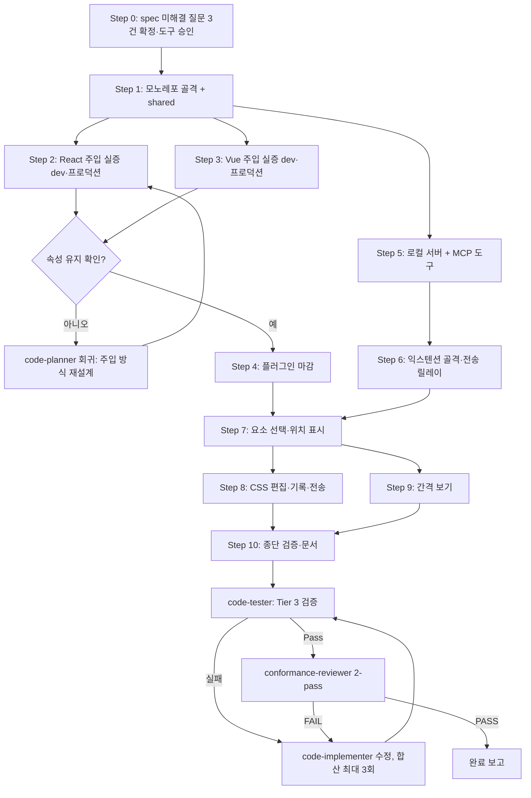

# Plan: 브라우저 클릭 CSS 수정의 소스 코드 반영 (프레임워크 무관 DOM→소스 매핑)

- Intent: [INT-001](intent.md) | Tier: 3 | 작성일: 2026-11-15
- Intent updated_at: 2026-11-15T22:38:35+09:00
- Spec: [spec.md](spec.md)

## 1. Tier 산정
- **Tier 3 (Major)**.
- 근거: 빈 저장소(커밋 0건)에 신규 프로젝트를 세우는 작업으로 패키지 4개(`plugin`·`extension`·`server`·`shared`)와 예제 2개를 만든다. 파일 수가 5개를 크게 넘고, 번들러·브라우저·MCP 세 실행 환경에 걸친다.
- 파괴적 변경: 없음(기존 코드·데이터 부재). 마이그레이션 없음.
- 하드 게이트 후보(신규 경로 감지): `packages/server`는 로컬 네트워크 리스너와 `Origin` 검증을 포함해 보안 신호에 해당한다.

## 2. 실행 순서 (Steps)
환경: macOS(Darwin 25.6.0), zsh, 저장소 `/Users/dev-juhee/dev-Joy/DOMirror` 브랜치 `main`(커밋 0건). 기존 `경로:라인` 참조 없음(코드베이스 부재). 원 요구는 spec §1 참조. 아래 경로는 spec §3의 제안(초안)이며 `code-planner`가 확정한다.

| Step | 목표 | 변경 파일 | 선행 | 검증 방법 | 롤백 |
| :--- | :--- | :--- | :--- | :--- | :--- |
| 0 | spec §10 미해결 질문 3건 확정, 패키지 매니저·테스트 도구 도입 승인 | (문서만) | - | spec §10 미완료 `[ ]` 0건 | 해당 없음 |
| 1 | 모노레포 골격 + `packages/shared`(속성명·`StyleChange`·주입기 인터페이스 타입) | 루트 설정, `packages/shared/*` | 0 | 타입 검사 통과 | 커밋 되돌리기 |
| 2 | **실증**: React 주입기 최소 구현 + `examples/react-vite`에서 dev·프로덕션 모드 빌드 모두 속성 존재 확인(R-1) | `packages/plugin/*`, `examples/react-vite/*` | 1 | 단위 테스트(변환 입출력) + 빌드 산출물 속성 검색(AC-1) | 커밋 되돌리기. 실패 시 `code-planner` 회귀 |
| 3 | **실증**: Vue 주입기 최소 구현 + `examples/vue-vite`에서 dev·프로덕션 모드 빌드 확인(A-2, S-6) | `packages/plugin/*`, `examples/vue-vite/*` | 1 | 단위 테스트 + 산출물 속성 검색(AC-2) | 커밋 되돌리기. 실패 시 `code-planner` 회귀 |
| 4 | 플러그인 마감: 켜기/끄기 옵션, 프로덕션 모드 경고, 상대 경로, 소스맵 유지, 주입기 등록 구조 | `packages/plugin/*` | 2, 3 | AC-3·AC-4 테스트, 끈 빌드 속성 0건 | 커밋 되돌리기 |
| 5 | 로컬 서버: 변경 내역 수신(127.0.0.1, `Origin` 검증)·보관 + MCP 도구 `list_pending_changes`·`mark_changes_applied` | `packages/server/*` | 0, 1 | 단위·통합 테스트(AC-7 서버 측, AC-10) | 커밋 되돌리기 |
| 6 | 익스텐션 골격(MV3): content script ↔ service worker 메시지, 서버 전송 릴레이, 실패 시 내역 유지 | `packages/extension/*` | 1, 5 | 단위 테스트 + 브라우저 수동 로드(AC-11) | 커밋 되돌리기 |
| 7 | 요소 선택 + 소스 위치 표시(조상 위치 처리 포함) | `packages/extension/*` | 4, 6 | 브라우저 검증(AC-5) | 커밋 되돌리기 |
| 8 | CSS 편집 패널 + 변경 기록·합치기·되돌리기 + 전송 | `packages/extension/*` | 7 | 단위 테스트(기록 합치기) + 브라우저 검증(AC-6·AC-7) | 커밋 되돌리기 |
| 9 | 간격 보기(크기·padding·gap, 기준 요소 고정 후 거리) | `packages/extension/*` | 7 | 브라우저 검증(AC-9) | 커밋 되돌리기 |
| 10 | 종단 검증: React·Vue 예제에서 편집 → 전송 → MCP 에이전트 반영 → 화면 확인, 사용 문서 | `README.md`, 예제 | 4, 5, 8, 9 | AC-8 수동 시나리오 + 전체 빌드·린트·테스트 | 커밋 되돌리기 |

- 각 Step은 1커밋·1검증 단위다. Step 2·3은 설계 가정(A-1·A-2)과 최대 리스크(R-1)를 먼저 깨 보는 실증 단계이므로 순서를 바꾸지 않는다.

## 3. Intent 태스크 매핑
intent `## 작업`에는 `T-01 [P2] (착수 시 분해 예정)` 1건만 있다. 전 Step이 T-01에 속하며, 세부 분해는 착수 시 intent에 반영한다.

| Step | intent 태스크 | 대응 요구 |
| :--- | :--- | :--- |
| 0 | T-01 (intent.md에 태스크 미분해) | spec §10 |
| 1 | T-01 | FR-4 |
| 2 | T-01 | FR-1·FR-3 |
| 3 | T-01 | FR-2·FR-3 |
| 4 | T-01 | FR-3·FR-4, NFR-2·NFR-4 |
| 5 | T-01 | FR-10·FR-12, NFR-1 |
| 6 | T-01 | FR-9, NFR-3 |
| 7 | T-01 | FR-5 |
| 8 | T-01 | FR-6·FR-7·FR-8·FR-9 |
| 9 | T-01 | FR-11 |
| 10 | T-01 | 제안 결과 종단(AC-8) |

- 인계 지시 대응: intent의 "spec 착수 시 첫 행동은 사실 조사(`researcher` 위임)"는 완료(spec §9 조사 사실표). 다음 행동은 Step 0이다.

## 4. 검증 계획 (DoD)
- 게이트: 필수(하드) / 근거: ① Tier 3, ④ 보안(로컬 리스너·`Origin` 검증) / 방식: 2-pass
- Tier 3 완료 조건: 전체 빌드·정적 분석(타입 검사·린트)·테스트 통과 + 브라우저 검증(콘솔 에러 0건, 정상 렌더링).
- 브라우저 검증 도구 우선순위: `ego-browser` → `Aside MCP` → 프로젝트 E2E(Playwright 등). 이번 세션에서 `aside` MCP는 연결 실패 상태였다. 모두 불가하면 미수행 사유를 보고한다.
- 익스텐션 검증 한계: 압축 해제 익스텐션 로드와 익스텐션 UI 조작은 자동화 도구에 따라 불가할 수 있다. 불가 시 AC-5·AC-6·AC-9는 사용자 수동 확인으로 대체하고 그 사실을 보고한다.
- AC-8(에이전트 종단)은 에이전트 동작에 의존하므로 수동 시나리오 1회 수행 결과를 기록한다(자동 테스트 대상 아님).
- 검증 명령: 도구 미정(Step 0에서 확정). 재현 명령·실측 수치는 intent에 없다.
- 완료 보고에는 §A 기록 4필드를 남긴다.

## 5. 리스크 · 파급
- 브레이킹 체인지·마이그레이션: 없음(신규 프로젝트). 롤백은 Step 단위 커밋 되돌리기.
- 문제·영향 대응: 대상 사용자는 AI 에이전트로 코드를 수정하는 프런트엔드 개발자(요청자). 대상 프로젝트에는 번들러 설정에 플러그인 등록 1건만 요구한다.
- 제약 준수: React 전용 설계 금지 → Step 2·3에서 React와 Vue를 같은 주입기 인터페이스로 실증한다. 운영 배포물에 위치 정보 미포함 → Step 4의 끄기 기본값·경고.
- 결정 반영: D-01(1개 intent 유지, 3개 분해 폐기), D-02(P2), D-03(간격 보기만 추가, 컴포넌트 이름 표시·코멘트·프롬프트 복사·하네스는 INBOX `IDEA-20261115-03`~`06`).
- 범위 밖·전제: Angular·Svelte 주입기, 스타일 방식별 변환 로직, VisBug 연동, zAgentSet 스킬(`IDEA-20261115-01`·`02`)은 이 plan에 Step이 없다. "빌드 후에도 찾기"는 실증 전 가정이다.
- 주요 리스크(spec §9): R-1 프로덕션 모드 주입 선행 사례 없음(Step 2·3에서 조기 실증, 실패 시 `code-planner` 회귀) / R-2 Turbopack은 unplugin 미지원 / R-3 MCP SDK v1·v2 선택과 다중 세션 포트 충돌 / R-4 반영 품질은 에이전트 의존 / R-5 CSP·로컬 네트워크 정책 미조사.
- 미확정·가정: spec §10 3건이 Step 0의 선행 조건이며, 미확정 상태로는 Step 5(서버)와 Step 2의 번들러 엔트리 범위를 정할 수 없다. A-3(TypeScript 모노레포)의 도구 도입은 사용자 승인 대상이다.
- 수정 루프: `code-implementer` ↔ `code-tester` ↔ `conformance-reviewer` 수정 요청 합산 최대 3회.

## 6. 실행 흐름

