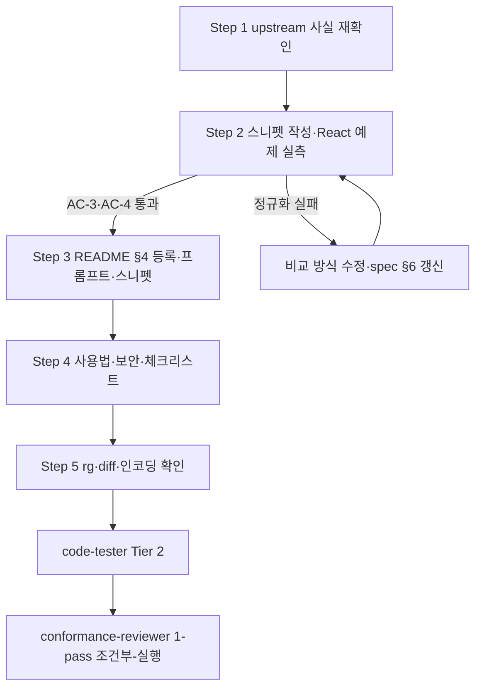

# Plan: chrome-devtools-mcp로 소스 반영 결과 자동 확인 (워크플로 문서화)
- Intent: [INT-002](intent.md) | Tier: 2 | 작성일: 2026-11-17
- Intent updated_at: 2026-11-17T12:06:29+09:00
- Spec: [spec.md](spec.md)

## 1. Tier 산정
- Tier 2 (Standard). 변경 파일은 `README.md` 1개로 코드 diff 0건이다. 하지만 사용자 워크플로·보안 안내를 새로 정의하고, 검증 스니펫의 동작을 예제 앱에서 실측해야 해서(AC-3·AC-4) Tier 1의 "비시맨틱 문서 교정"을 넘는다.
- 하드 게이트 후보: 아님. `README.md`는 `[배포·계약 자산 경로]`가 아니고 MCP 계약 변경 0건이다.

## 2. 실행 순서 (Steps)
1. 사실 재확인: upstream chrome-devtools-mcp README·`docs/tool-reference.md`로 `--isolated`·`--no-usage-statistics`·`--no-performance-crux`·`new_page`·`navigate_page`·`wait_for`·`evaluate_script`를 확인한다(NFR-3). 변경 발견 시 spec §6 초안을 갱신한다. 롤백: 해당 없음(읽기).
2. 검증 스니펫 작성·실측: spec §6 계약대로 JS를 작성한다. `pnpm --filter example-react-vite dev`(5173, `DOMIRROR=1`)에서 브라우저 도구(ego-browser → Aside MCP → Playwright)로 실행해 AC-3 세 가지 결과와 AC-4 인라인 `!important` 차이를 실측한다. 롤백: 스니펫 폐기.
3. README §4 수정(`README.md:126` 섹션): 등록 명령(FR-1), 별도 브라우저 이유(FR-2), 검증 프롬프트 예(FR-3·FR-5), 스니펫(FR-4)을 추가한다. 기존 domirror 명령(`README.md:131`)과 기존 프롬프트 예(`README.md:147-152`)는 보존한다. 롤백: `git checkout -- README.md`.
4. README 사용법 8단계(`README.md:163`) 병기(FR-6), 보안 주의(`README.md:167`) 3항목(FR-7), 체크리스트(`README.md:196`) 1건(FR-8)을 추가한다. 롤백: 동일.
5. 형식·범위 확인: `rg -n` AC-1·AC-2·AC-5, `git diff --stat -- packages examples` 0줄, CR·BOM 확인(AC-6). 롤백: 해당 없음.

## 3. Intent 태스크 매핑
- `T-01` (착수 시 분해 예정) → Step 1~5 전체. intent.md에 태스크가 아직 분해되지 않아 구현 착수 시 T-01을 Step 단위로 분해해 기록한다.
- 제안 결과 매핑: 등록 안내 → Step 3(FR-1) / 검증 프롬프트 예 → Step 3(FR-3·FR-4) / 불일치 시 표시 보류 → Step 3(FR-5) / 새로고침 없이 확인 → Step 4(FR-6)

## 4. 검증 계획 (DoD)
- code-tester(Tier 2):
  - Step 2 실측 결과(AC-3 세 가지 status, AC-4 차이 1줄)
  - `rg -n "chrome-devtools-mcp|--isolated|--no-usage-statistics|--no-performance-crux|evaluate_script|mark_changes_applied" README.md`
  - `git diff --stat -- packages examples`(0줄)
  - README CR 0건·BOM 없음
  - 회귀 확인: `pnpm lint`(oxlint)·`pnpm test` Exit 0
- 브라우저 도구가 모두 불가하면 AC-3·AC-4는 미수행 사유를 보고하고, 종단 확인은 README 수동 체크리스트(FR-8)로 남긴다.
- 게이트: 조건부-실행 / 근거: 저위험 ③ 미충족(FR 8건·AC 6건 > 3) / 방식: 1-pass

## 5. 리스크 · 파급
- upstream 플래그·도구명 변경(spec A-1) → Step 1 재확인과 README 확인 기준일로 완화한다.
- 계산값 정규화 비교 실패(spec A-2·E-2) → Step 2 실측. 실패 시 스니펫의 비교 방식을 바꾸고 spec §6를 갱신한다(요구 변경이면 intent 갱신 후 specplan 재실행).
- 종단(에이전트 + 두 MCP) 자동 검증 불가(spec R-1) → 수동 체크리스트로 남기고 완료 보고에 명시한다.
- 전송 완료 항목의 원복 여부 미확인(spec R-2) → 별도 브라우저 권장으로 회피한다.
- 파급: README만 변경하므로 패키지·예제·MCP 계약 영향은 0이다. 범위 밖: 익스텐션 대체·E2E 자동화·서버 설계(intent D-01).
- 결정 계승: intent D-01~D-03, spec D-S1(`--isolated` 기본 실행)·D-S2(재로딩 + `wait_for`).

## 6. 실행 흐름

