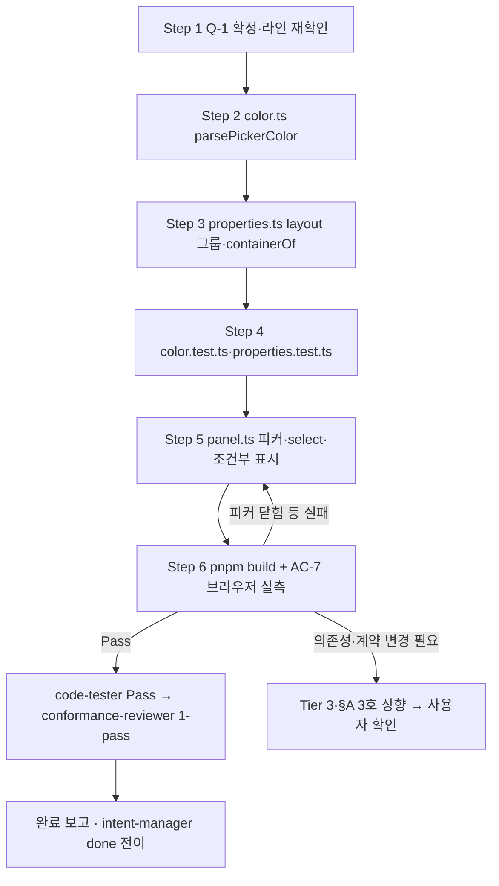

# Plan: CSS 편집 패널 확장 — 컬러 피커와 flex/grid 레이아웃 속성 편집
- Intent: [INT-009](intent.md) | Tier: 2 | 작성일: 2026-11-18
- Intent updated_at: 2026-11-17T23:59:16+09:00
- Spec: [spec.md](spec.md)

## 1. Tier 산정
- 등급은 Tier 2(Standard)다.
  - 변경은 extension 패키지에 한정된다(6개 파일): `properties.ts`·`panel.ts` 수정, `content.ts` 1줄 추가(FR-8 display 재렌더), 신규 `color.ts`·`color.test.ts`·`properties.test.ts`.
  - `EditableProperty` 타입 확장은 익스텐션 내부 타입이며 선택 필드 추가라 기존 import 지점(`panel.ts:4`·`content.ts:46`)이 깨지지 않는다.
  - 공개 계약(`StyleChange`·MCP 도구·서버·manifest)과 의존성은 바꾸지 않는다(spec NFR-1·NFR-2).
  - UI 동작 변경이므로 AC-7 브라우저 실측을 검증에 포함한다.
- 하드 게이트 후보는 아니다(`[배포·계약 자산 경로]` 해당 없음).
- 상향 조건: 외부 컬러 피커 의존성 도입, `StyleChange`·`prompt.ts` 변경이 필요해지면 Tier 3·§A 3호로 상향하고 사용자 확인 후 진행한다. spec §10 Q-1은 (a)로 확정되어 `EditorHandlers`는 변경하지 않는다.
- intent D-01(P2)·D-02(1개 intent 유지)·D-03(기존 변경 내역 경로)을 따른다.

## 2. 실행 순서 (Steps)
1. 착수 전 확인
   - spec §10 Q-1 답변 확정 여부를 확인한다(미확정이면 착수하지 않는다).
   - `git log -5 -- packages/extension/src/properties.ts packages/extension/src/panel.ts packages/extension/src/content.ts`로 다른 intent(INT-007·INT-008 등)의 병행 수정을 확인하고, spec §3 인용 라인(`properties.ts:3`·`:5-8`·`:19-30`, `panel.ts:145-162`·`:172`, `content.ts:596-597`)을 재확인한다. 어긋나면 심볼 기준으로 위치를 다시 잡는다.
   - 롤백: 해당 없음.
2. 색 변환 모듈: `packages/extension/src/color.ts` 신규(`parsePickerColor`, spec §6).
   - 검증: `pnpm --filter @domirror/extension typecheck`
   - 롤백: 파일 삭제.
3. 속성 정의: `packages/extension/src/properties.ts` 수정.
   - `PropertyGroup`에 `'layout'`, `LayoutContainer` 타입, `EditableProperty.options?`·`containers?`, `PROPERTY_GROUP_LABELS.layout = '레이아웃'`, `containerOf()` 추가.
   - `EDITABLE_PROPERTIES` 끝에 spec §6 표의 10개를 연속 배치한다. 1행 롱핸드 원칙 주석은 유지한다.
   - 검증: `pnpm typecheck`
   - 롤백: `git checkout -- packages/extension/src/properties.ts`
4. 단위 테스트: `packages/extension/test/color.test.ts`(AC-1), `packages/extension/test/properties.test.ts`(AC-2·AC-3 정적 부분) 신규.
   - 검증: `pnpm test`
   - 롤백: 파일 삭제.
5. 패널 렌더링: `packages/extension/src/panel.ts` `renderEditor` 수정.
   - 순회 시 `containers`가 있으면 `containerOf(values?.display)`가 포함될 때만 그린다(FR-6). 그룹 내 표시 항목이 0개인 그룹은 헤더도 생략한다.
   - `options`가 있으면 `<select>`(현재값이 목록 밖이면 맨 앞에 추가, FR-7), `change` → `onEdit`.
   - `group === 'color'`면 텍스트 입력 + `<input type="color">` 병행(FR-1~FR-3). 피커 이벤트는 Q-1 답변대로 연결하고 `onEdit` 후 텍스트 값도 동기화한다.
   - 피커·select에도 `disabled`·`dataset.property`를 적용한다(FR-10).
   - `EDITOR_CSS`(`:98-104`)에 피커·select 배치 스타일 추가.
   - Q-1 = (a) 확정: 피커는 `change` 시 1회 `onEdit`, `EditorHandlers`·`onPreview` 추가 없음.
   - FR-8: `content.ts` `#edit` 성공 경로 끝에 property가 display이면 `#renderEditor()` 재호출 1줄 추가.
   - 검증: `pnpm typecheck`·`pnpm lint`
   - 롤백: `git checkout -- packages/extension/src/panel.ts packages/extension/src/content.ts`
6. 빌드·실측: `pnpm build` 후 `examples/react-vite`를 띄우고(`pnpm --dir examples/react-vite dev --port 5199` 시도, 실패 시 기본 5173 사용 후 보고에 실제 포트 기록) 빌드한 익스텐션으로 spec AC-7 ①~⑤와 AC-5를 확인한다. ⑤·AC-5 전송 부분은 `node packages/server/dist/cli.js` 기동 상태에서 확인한다.
   - 롤백: 해당 없음. 실패하면 Step 5로 회귀한다.

## 3. Intent 태스크 매핑
- (intent.md에 태스크 미분해 — `T-01 [P2] (착수 시 분해 예정)`)
- 착수 시 분해 제안(intent 갱신은 intent-manager 소관이며 이 plan은 제안만 한다):
  - T-01: 색 변환 모듈과 테스트(Step 2·4, AC-1)
  - T-02: 레이아웃 속성 정의와 테스트(Step 3·4, AC-2·AC-3)
  - T-03: 패널 피커·select·조건부 표시(Step 5, FR-1~FR-10)
  - T-04: 빌드·브라우저 실측(Step 6, AC-4~AC-7)
- 인계 지시(intent `z_skill_intent_to_specplan`)는 이 문서와 spec.md로 완료했다. 다음 단계는 spec §10 Q-1 확정과 사용자의 명시적 구현 지시다.

## 4. 검증 계획 (DoD)
- code-tester가 Tier 2 표준 검증과 브라우저 실측을 수행한다.
  - `pnpm lint`(oxlint)·`pnpm typecheck`·`pnpm test`(vitest)·`pnpm build` 모두 Exit 0.
  - AC-1·AC-2는 `color.test.ts`·`properties.test.ts` 자동 테스트로 확인한다.
  - AC-4: `git diff --stat -- packages/shared packages/server packages/extension/manifest.json packages/extension/src/prompt.ts package.json packages/extension/package.json pnpm-lock.yaml` 0줄.
  - AC-3(`CSS.supports` 유효성)·AC-5·AC-7은 `examples/react-vite` + 빌드한 익스텐션으로 실측한다. 도구 순서는 `ego-browser → Aside MCP → Playwright`, 콘솔 에러 0건. 모든 도구가 불가하면 미수행 사유와 수동 체크리스트를 완료 보고에 남긴다.
  - 신규·수정 파일 CR 0건·BOM 없음.
- 게이트: 조건부-실행 / 근거: ③ 미충족(intent 연계 FR 10건·AC 7건 > 3), ① 미충족(변경 파일 6개 > 3) / 방식: 1-pass

## 5. 리스크 · 파급
- R-1 (재렌더와 피커): `panel.ts:172` `replaceChildren`로 피커가 닫힐 수 있다. Q-1 결정과 AC-7 ②로 확인하고, 실패 시 Step 5로 회귀한다.
- R-2 (`gap` 중복): 기존 `gap`은 유지(최소 변경). 정리는 후속 INBOX 아이디어 후보로 완료 보고에 1줄 남긴다.
- R-3 (grid 예제 부재): `.list` display 변경으로 대체 검증(AC-7 ④).
- R-4 (`display: none`): 선택·측정 어긋남 가능. 기존 원복 경로로 되돌린다.
- R-5 (병행 intent): INT-007·INT-008(planned)이 `content.ts`·`panel.ts`를 건드릴 수 있다. Step 1에서 라인 재확인.
- 파급: 서버·shared·MCP·프롬프트 형식 영향 없음. 기존 16개 속성의 텍스트 편집은 그대로이며 AC-7 ①·②로 회귀를 확인한다.
- 범위 밖 재확인: 자식 아이템 속성·자유 입력·자체 피커·레이아웃 전용 프롬프트·intent 분해는 넣지 않는다(intent 미해결 질문 답변·D-03).
- 결정 근거: intent D-01~D-03, spec D-S1~D-S4.

## 6. 실행 흐름

