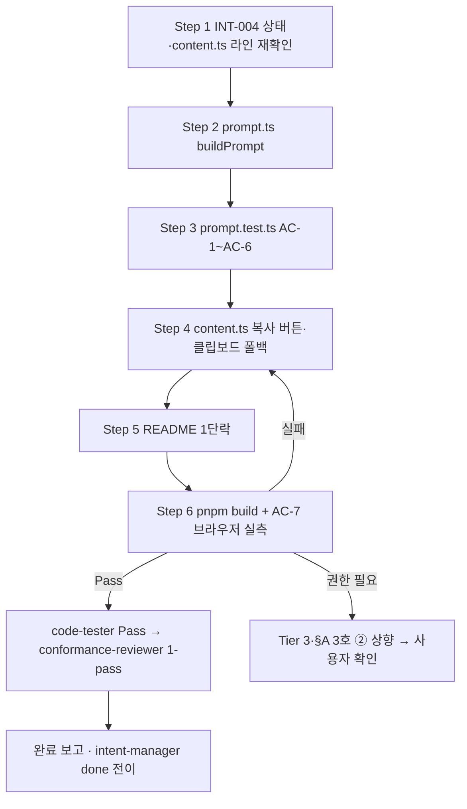

# Plan: 선택 요소·변경 내역을 AI 구현 프롬프트로 복사
- Intent: [INT-006](intent.md) | Tier: 2 | 작성일: 2026-11-17
- Intent updated_at: 2026-11-17T15:58:52+09:00
- Spec: [spec.md](spec.md)

## 1. Tier 산정
- 등급은 Tier 2(Standard)다.
  - 변경은 extension 패키지에 한정된다: 신규 `prompt.ts`·`prompt.test.ts`, `content.ts` 버튼·핸들러. 여기에 README 1단락이 더해진다.
  - 공개 계약(MCP 도구·HTTP 경로·shared 타입·manifest 권한)은 바꾸지 않는다(spec NFR-1).
  - 보안 경계(서버 Host·Origin 검증)도 건드리지 않는다.
  - 다만 클립보드라는 새 브라우저 API를 쓰므로 AC-7 브라우저 실측을 검증에 포함한다.
- 하드 게이트 후보는 아니다(`[배포·계약 자산 경로]` 해당 없음).
- 상향 조건: AC-7 실측에서 manifest 권한 추가(`clipboardWrite`)가 필요해지면 계약 변경이 된다. 그때는 Tier 3·§A 3호 ②로 상향하고 사용자 확인 후 진행한다(spec D-S3).
- intent D-01(P2)과 D-02(별도 intent 진행)를 따른다.

## 2. 실행 순서 (Steps)
1. 착수 전 확인(R-1): INT-004 진행 상태를 확인한다.
   - `git log -5 -- packages/extension/src/content.ts packages/extension/src/panel.ts`
   - spec §3의 `content.ts` 인용 라인(`:78`·`:123`·`:135`·`:139`·`:205`·`:235`·`:268`)을 재확인한다. 어긋나면 심볼 기준으로 위치를 다시 잡는다(설계 변경 없음).
   - 롤백: 해당 없음.
2. 프롬프트 모듈: `packages/extension/src/prompt.ts`를 신규 작성한다(spec §6 시그니처).
   - `buildPrompt`, 인라인 코드 이스케이프 헬퍼(E-2), 위치 표기 헬퍼를 둔다. 위치 표기는 `formatSourceLocation`과 `(조상 위치)`를 쓰고, 위치가 없으면 `위치 미확인`으로 적는다.
   - 의존은 `change-log.ts`(`originalValue`, 타입), `source-locator.ts`(`Located` 타입), `@domirror/shared`(`formatSourceLocation`)뿐이다.
   - 검증: `pnpm --filter @domirror/extension typecheck`
   - 롤백: 파일 삭제.
3. 단위 테스트: `packages/extension/test/prompt.test.ts`를 신규 작성한다. AC-1~AC-5를 케이스로 만들고, AC-6 후반의 절대 경로 문자열 부재 검사도 넣는다.
   - 검증: `pnpm test`
   - 롤백: 파일 삭제.
4. 패널 연결: `packages/extension/src/content.ts`를 수정한다.
   - `SendHandlers`에 `promptInput()`을 추가한다.
   - `sendRow`에 `AI 프롬프트 복사` 버튼을 추가한다(`type='button'`).
   - 클릭 핸들러를 만든다. 순서: `promptInput()` → null이면 FR-4 → `buildPrompt` → 클립보드 쓰기(`navigator.clipboard.writeText`, 실패 시 shadow 안 임시 textarea + `execCommand('copy')`) → FR-8 상태 표시.
   - dispose에서 리스너를 해제한다.
   - `EditSession.promptInput()`을 구현한다. `#log`가 있으면 changes, 없으면 `#selected`에서 `selectorHint`·`locate`·`location.href`로 selection을 만든다.
   - `createPanel` 호출부(`promptInput: () => current.promptInput()`)도 연결한다.
   - 전송 중 잠금과 무관하게 버튼을 활성 상태로 둔다(FR-1).
   - 검증: `pnpm typecheck`·`pnpm lint`
   - 롤백: `git checkout -- packages/extension/src/content.ts`
5. 문서: `README.md` 사용법에 복사 기능 1단락을 추가한다. 내용은 MCP 미사용 도구용이라는 점, 내역 전체 또는 선택 요소 위치를 복사한다는 점, 복사가 내역을 바꾸지 않는다는 점, 페이지 URL이 포함된다는 점(R-3)이다.
   - 롤백: `git checkout -- README.md`
6. 빌드·실측: `pnpm build`로 빌드한 뒤 `examples/react-vite`에서 AC-7 ①~④를 확인한다.
   - ④는 `node packages/server/dist/cli.js`를 띄운 상태에서 확인한다.
   - 클립보드 내용은 붙여 넣기나 `navigator.clipboard.readText`(페이지 컨텍스트)로 확인한다.
   - 롤백: 해당 없음. 실패하면 Step 4로 회귀하고, 권한이 필요하면 §1 상향 조건을 적용한다.

## 3. Intent 태스크 매핑
- (intent.md에 태스크 미분해 — `T-01 [P2] (착수 시 분해 예정)`)
- 착수 시 분해 제안(intent 갱신은 intent-manager 소관이며 이 plan은 제안만 한다):
  - T-01: 프롬프트 생성 모듈과 단위 테스트(Step 2·3, AC-1~AC-6)
  - T-02: 패널 복사 버튼과 클립보드 연결(Step 4, AC-7·AC-8)
  - T-03: README 사용법 보강(Step 5)
- 인계 지시(intent `z_skill_intent_to_specplan`)는 이 문서와 spec.md로 완료했다. 다음 단계는 사용자의 명시적인 구현 지시다.

## 4. 검증 계획 (DoD)
- code-tester가 Tier 2 표준 검증과 브라우저 실측을 수행한다.
  - `pnpm lint`(oxlint)·`pnpm typecheck`·`pnpm test`(vitest)·`pnpm build`가 모두 Exit 0이어야 한다.
  - AC-1~AC-5는 `packages/extension/test/prompt.test.ts` 자동 테스트로 확인한다.
  - AC-6: `git diff --stat -- packages/shared packages/server packages/extension/manifest.json`이 0줄이어야 한다.
  - AC-7 브라우저 실측 환경은 `examples/react-vite` + 빌드한 익스텐션(+ ④는 `node packages/server/dist/cli.js`)이다.
    - 도구 순서는 `ego-browser → Aside MCP → Playwright`다.
    - 콘솔 에러는 0건이어야 한다.
    - 모든 도구가 불가하면 미수행 사유와 수동 체크리스트를 완료 보고에 남긴다.
  - 신규·수정 파일은 CR 0건·BOM 없음이어야 한다.
- 게이트: 조건부-실행 / 근거: ③ 미충족(intent 연계 FR 9건·AC 8건 > 3), ① 미충족 가능(파일 4개·README 포함 2개 최상위 경로) / 방식: 1-pass

## 5. 리스크 · 파급
- R-1 (INT-004 병행 수정): `content.ts`·`panel.ts`가 겹친다. Step 1에서 라인을 재확인하고 심볼 기준으로 편집한다. INT-004 완료 후 착수하는 것을 권장한다.
- R-2 (`execCommand` 폐기 예정): 1순위로 `navigator.clipboard`를 쓴다. 폴백까지 실패하면 오류 문구로 알리고 내역은 바꾸지 않는다(spec E-4).
- R-3 (페이지 URL 외부 노출): README에 명시한다. 프롬프트에서 URL을 지우는 처리는 하지 않는다. MCP 전송과 같은 값이며, intent가 요구한 정보 항목에 포함되어 있기 때문이다.
- 파급: 서버·shared·plugin·MCP 계약은 영향이 없다. 기존 `에이전트에 보내기` 흐름은 FR-9·AC-7 ④로 회귀를 확인한다.
- 범위 밖 재확인(intent 「범위 밖·전제」): AI 자동 전달·실행은 넣지 않는다. 복사 후 내역 변경도 넣지 않는다(미해결 질문 답변: 읽기 전용, MCP와 병행).
- 결정 근거: intent D-01·D-02, spec D-S1~D-S4. MCP 대체안은 미해결 질문 답변으로 기각했다.

## 6. 실행 흐름

