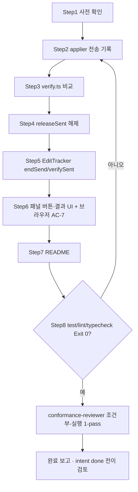

# Plan: 소스 반영 확인 시 익스텐션 인라인 !important 값 해제·원복
- Intent: [INT-008](intent.md) | Tier: 2 | 작성일: 2026-11-17
- Intent updated_at: 2026-11-17T16:03:47+09:00
- Spec: [spec.md](spec.md)

## 1. Tier 산정
- 판정: Tier 2 (Standard).
  - 변경은 `packages/extension` 단일 패키지 안에 머문다: `applier.ts`·`edit-tracker.ts`·`content.ts`·`panel.ts`·신규 `verify.ts`와 테스트. 여기에 `README.md`가 더해진다.
  - 서버·shared·MCP 계약 변경은 0건이다.
  - 다만 사용자 동작(전송 후 표시·되돌리기 의미)과 패널 UI가 바뀌고 F-E 브라우저 실측(AC-7)이 필요하다. 그래서 Tier 1을 넘는다.
  - 전역 구조 개편과 브레이킹 체인지가 없으므로 Tier 3에는 미달한다.
- 하드 게이트 후보: 아님. `packages/extension/**`·`README.md`는 `[배포·계약 자산 경로]`가 아니고, 공개 계약 변경도 0건이다.

## 2. 실행 순서 (Steps)
1. 사전 확인
   - 내용
     - 작업 트리 상태를 확인한다. 조사 시점에는 무관한 `source-locator.ts` 수정이 있었다(spec R-4).
     - spec §3 `경로:라인`을 재확인한다(원 요구 IDEA-20261117-01, HEAD `49319db` 기준).
   - 검증: `git status`, 인용 줄 발췌 일치.
   - 롤백: 해당 없음(읽기).
2. `applier.ts` 전송 기록 (FR-1·FR-6, D-S3·D-S5)
   - 내용
     - `#sent: Map<string, SentRecord>`, `markSent`, `sentCount`를 추가한다.
     - `restoreAll`에서 `#sent.clear()`를 호출한다.
     - `forget`은 남기되 `endSend`에서는 쓰지 않는다.
   - 검증: `applier.test.ts`에 AC-1·AC-6(restoreAll) 테스트를 추가한다.
   - 롤백: 파일 `git checkout`.
3. `verify.ts` 비교 로직 (FR-4·FR-5, D-S1·D-S4)
   - 내용
     - `ReadComputed` 주입형 측정 함수를 만든다. 측정 순서는 transition 임시 none → 해제 상태 actual → 보낸 값 임시 적용 expected → 해제 상태 복귀 → transition 원복이다.
     - 요소 판정과 항목 합산 규칙을 구현한다.
   - 검증: 신규 `verify.test.ts`에 AC-5 테스트를 작성한다. `FakeElement`와 가짜 reader를 쓴다.
   - 롤백: 파일 삭제.
4. `applier.releaseSent` 해제 (FR-3, D-S2)
   - 내용
     - 전송 기록의 요소를 `restoreStyle(prev)`로 원복한다.
     - 같은 key의 활성 `#byKey` record가 있는 요소는 해제하지 않는다. 그 record의 `prev`를 교체하고 `pending-edit`로 표시한다.
     - 분리 요소는 `detached`로 표시한다. 처리가 끝나면 기록을 비운다.
   - 검증: AC-2·AC-3·AC-4 테스트.
   - 롤백: 파일 `git checkout`.
5. `edit-tracker.ts` (FR-1·FR-2, NFR-2)
   - 내용
     - `endSend`의 `forget`을 `markSent`로 바꾼다. 이때 `sent`의 `after`·`selectorHint`·`source`를 key별 마지막 값으로 넘긴다.
     - `sentCount`와 `verifySent(read)`를 추가한다. `sending` 중이면 `null`을 반환한다.
   - 검증: `edit-tracker.test.ts`에 AC-1·AC-6 잠금 테스트를 추가한다. 기존 L1~L5·D-1·D-2·F-1이 통과해야 한다.
   - 롤백: 파일 `git checkout`.
6. UI (FR-2·FR-5)
   - 내용
     - `content.ts` 전송 행(`:113`~`:126`)에 `반영 확인` 버튼을 추가한다. click을 등록·해제(`:205`·`:218` 패턴)하고, `SendHandlers`를 확장하거나 별도 핸들러를 연결한다.
     - 활성 조건은 `sentCount>0 && !sending`이다.
     - `verifySent(getComputedStyle 기반 reader)` 결과 요약을 `setStatus`로 보여준다.
     - `panel.ts`에 결과 목록 렌더 함수를 추가한다(`button()` 헬퍼·CSS 패턴 재사용).
   - 검증
     - `pnpm typecheck`
     - 브라우저 AC-7: `pnpm --filter example-react-vite dev`(5173). 브라우저 도구는 ego-browser → Aside MCP → Playwright 순이다.
     - 재현 환경: macOS(Darwin 25.6.0), README 예제에서 편집·전송 후 소스 미반영.
   - 롤백: 파일 `git checkout`.
7. README (FR-7)
   - 내용: `:170`·`:279`·사용법 확인 단계·수동 확인 체크리스트(`:290`~`:295` 뒤)를 갱신한다.
   - 검증: 해당 줄 발췌 확인(AC-8).
   - 롤백: 파일 `git checkout`.
8. 전체 검증
   - 내용: `pnpm test`·`pnpm lint`·`pnpm typecheck`를 실행한다.
   - 검증: Exit 0(AC-8).
   - 롤백: 실패 시 해당 Step으로 회귀한다.

## 3. Intent 태스크 매핑
- intent의 `T-01 [P2] (착수 시 분해 예정)` → Step 1~8 전체.
- 착수(`planned`→`active`) 시 `intent-manager`가 아래처럼 분해하도록 권고한다.
  - T-01 전송 기록·해제·비교: Step 2~5
  - T-02 패널 UI: Step 6
  - T-03 README: Step 7
- 인계 지시 "미해결 질문 확정 후 `z_skill_intent_to_specplan`"은 이번 산출로 충족했다. 다음은 사용자 명시 지시 후 구현 파이프라인이다.

## 4. 검증 계획 (DoD)
- 단위(vitest): AC-1~AC-6. 대상은 `packages/extension/test/applier.test.ts`·`edit-tracker.test.ts`·신규 `verify.test.ts`이며 기존 테스트도 전부 통과해야 한다.
- 정적: `pnpm lint`(oxlint .), `pnpm typecheck`가 Exit 0이어야 한다.
- 브라우저: AC-7 (a) 불일치 (b) 일치 (c) 콘솔 에러 0건. 환경은 `examples/react-vite` dev 5173이다.
- 문서: AC-8 README 4곳.
- 게이트: 조건부-실행 / 근거: 저위험 조건 ①(변경 파일 >3개)·③(FR 7건+AC 8건 >3) 미충족 / 방식: 1-pass

## 5. 리스크 · 파급
- 문제·영향: 같은 탭에서 반영 실패가 가려지는 문제(intent `## 문제`)를 해소한다. 파급은 익스텐션 패널과 전송 후 표시 동작에 한정된다.
- 제약·불변
  - 인라인 style만 쓴다(`applier.ts:1`).
  - 전송 잠금(`edit-tracker.ts:43`~`:59`)과 끌 때 원복(NFR-3)을 유지한다.
  - 서버 계약 변경은 0건이다.
  - INT-002 별도 브라우저 회피책(README `:154` 이하, `:170`)을 유지한다.
- 결정·폐기 대안
  - D-02: 인라인 적용 제거안은 폐기했다.
  - D-S1: 임시 형제 요소·문자열 비교는 폐기했다.
  - D-S2: 재편집 값까지 해제하는 안은 폐기했다.
- 범위 밖: INT-002 워크플로, 서버 HTTP 경로 추가, HMR·새로고침 자동 트리거.
- 리스크와 대응
  - R-1 애니메이션 거짓 일치: 알려진 한계로 둔다.
  - R-2 transition 원복: `PrevInline` 방식으로 단일 속성만 저장한다.
  - R-3 README `:279` 동작 변경: Step 7에서 갱신한다.
  - R-4 무관한 작업 트리 변경: Step 1에서 확인한다.
- 미확정: 없음. spec §10은 모두 `[x]`이고, D-S1~D-S5는 권장안 확정이며 이의가 있으면 갱신한다.

## 6. 실행 흐름

