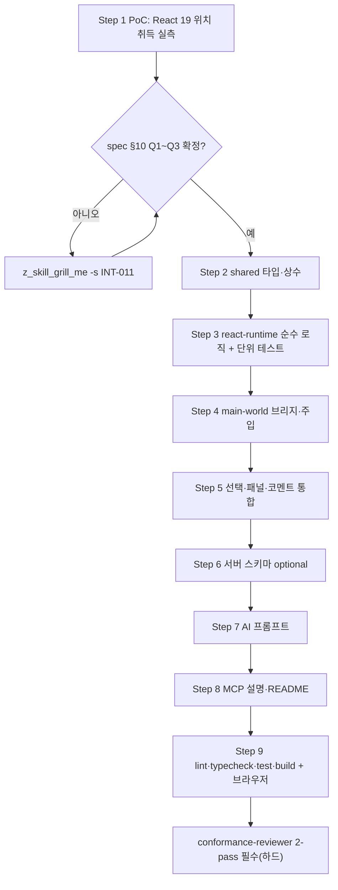

# Plan: React 런타임·DevTools 연동 컴포넌트 위치 찾기와 프롬프트 기반 소스 수정
- Intent: [INT-011](intent.md) | Tier: 3 | 작성일: 2026-11-19
- Intent updated_at: 2026-11-19T23:32:59+09:00
- Spec: [spec.md](spec.md)

## 1. Tier 산정
- 판정: Tier 3 (Strict).
  - 변경이 4개 영역에 걸친다: `packages/extension`·`packages/shared`·`packages/server`·`README.md`.
  - 새 실행 컨텍스트(main-world 브리지)와 빌드 엔트리(`packages/extension/build.mjs:9-12`)·주입 경로(`packages/extension/src/service-worker.ts:16`)가 바뀐다.
  - 공개 계약이 바뀐다: `ScreenCommentInputSchema`(`packages/server/src/schema.ts:53-65`)와 MCP 도구 설명(`packages/server/src/mcp.ts:52-68`).
  - 실제 React 19 동작은 단위 테스트로 증명할 수 없어 브라우저 실측이 필수다.
- 하드 게이트 후보: 해당한다. `packages/server/src/mcp.ts`는 §A `[배포·계약 자산 경로]`(`src/mcp/`)와 경로가 정확히 같지는 않다. 다만 코멘트 스키마·MCP 출력은 공개 계약 변경이므로 §A 3호②를 적용한다(①도 해당).

## 2. 실행 순서 (Steps)
- Step 1 — PoC: React 19 소스 위치 취득 수단 실측 (FR-12, AC-1)
  - 할 일: 플러그인을 끈 예제(`pnpm --filter example-react-vite exec vite`, `DOMIRROR` 미설정)를 macOS Chrome에서 연다. 콘솔(main world)에서 확인할 것은 다음과 같다.
    - 호스트 노드 `__reactFiber$*` 키
    - fiber의 `_debugStack`·`_debugOwner`·`type.name`
    - `__REACT_DEVTOOLS_GLOBAL_HOOK__.renderers` 유무(DevTools 설치·미설치 2회)
    - 스택 프레임 URL·라인과 원본 라인의 차이
  - 산출: `docs/intent/planned/INT-011-react-runtime-locate-prompt-fix/poc.md`에 필드 표와 라인 오차를 기록한다. spec §10 Q1 결정 근거로도 쓴다.
  - 검증: AC-1 항목이 모두 채워졌는지 확인한다. 롤백: 문서만 있으므로 삭제한다.
- Step 2 — 공유 타입·상수 (FR-5·FR-9 초안 확정)
  - 할 일: `packages/shared/src/types.ts`에 `LocationPrecision`·`RuntimeSourceRef`·`ComponentRuntimeInfo`와 `ScreenComment.component?`를 추가하고, `constants.ts`에 브리지 채널 상수를 추가한다. 배럴은 `packages/shared/src/index.ts`다.
  - 검증: `pnpm typecheck`. 롤백: 파일 단위로 되돌린다.
- Step 3 — 런타임 탐색 순수 로직 (FR-2~FR-5, E-4·E-5·E-6)
  - 할 일: `packages/extension/src/react-runtime.ts`(신규)를 만든다.
    - 구조적 fiber 인터페이스를 받아 다음을 수행하는 순수 함수를 둔다: 컴포넌트 fiber 탐색, 이름 해석(memo·forwardRef), `_debugSource`/`_debugStack` 프레임 파싱, Vite URL 정규화, 정확도 판정, owner chain(상한 8).
    - Q1 결과가 (b)이면 sourcemap 디코드는 별도 Step으로 분리한다.
  - 검증: `packages/extension/test/react-runtime.test.ts`(가짜 fiber)로 AC-4를 확인한다. 롤백: 신규 파일을 삭제한다.
- Step 4 — main-world 브리지·주입 (FR-1, NFR-3, E-1~E-3·E-11)
  - 할 일:
    - `packages/extension/src/page-bridge.ts`(신규, MAIN world): hook 우선, fiber 폴백. 마커 요소를 찾아 Step 3 함수를 호출하고 응답한다.
    - `build.mjs` 엔트리에 `page-bridge.js`를 추가한다.
    - `service-worker.ts:16` 주입 시 `world: 'MAIN'`으로 함께 주입한다.
    - content 측 요청 함수(타임아웃 300ms, id 검증)를 추가한다.
  - 검증: 메시지 검증 로직 단위 테스트(AC-9), `pnpm build`. 롤백: 엔트리·주입 줄을 되돌리면 기존 동작으로 복귀한다.
- Step 5 — 선택·패널·코멘트 통합 (FR-6~FR-9, NFR-1, E-8~E-10)
  - 할 일:
    - `content.ts:489-498` `select`에서 브리지 결과를 받아 `LocationView`(`panel.ts:12-22`)에 호출부·계층·정확도를 넣고 `componentLines`(`panel.ts:56-67`)를 확장한다.
    - `#submitComment`(`content.ts:692-733`)의 차단 조건(`:711-716`)을 FR-8로 바꾸고 `component`를 싣는다.
    - `source` 채움은 Q2 결과를 따른다. `#renderCommentForm`(`:783-789`) 힌트를 바꾼다.
    - `comment-log.ts:95-109`가 `component`를 관대하게 복원하도록 한다.
    - 핀 앵커 `comment-ui.ts:259`는 Q3 결과를 따른다.
  - 검증: `comment-log.test.ts`·`source-locator.test.ts` 기존 단언을 무수정으로 통과하고, 신규 케이스를 추가한다. 롤백: Step 단위 revert.
- Step 6 — 서버 계약 (FR-9, NFR-2)
  - 할 일: `schema.ts:53-65`에 `component` optional 스키마를 추가한다.
  - 검증: `http.integration.test.ts`에 component 유·무 POST 200과 `list_comments` 포함 여부를 추가한다(AC-6). 도구 이름 단언 `:101-106`은 불변이다. 롤백: 스키마 줄 revert.
- Step 7 — AI 프롬프트 (FR-10)
  - 할 일: `prompt.ts` `PromptSelection`(`:9-14`)과 변경 위치 직렬화(`where()` `:37-41`, `:112`·`:129`·`:135`)에 컴포넌트·호출부·계층·정확도 줄을 추가한다. 런타임 정보가 없으면 기존 문자열 그대로다. `promptInput()`(`content.ts:519-524`)이 정보를 넘긴다.
  - 검증: `prompt.test.ts` 기존 단언 무수정 통과 + 신규 케이스(AC-7). 롤백: revert.
- Step 8 — MCP 설명·README (FR-11)
  - 할 일:
    - `mcp.ts:52-68`의 `list_comments`·`mark_comments_resolved` description에 반영 흐름을 추가한다.
    - `README.md`를 갱신한다: `:140-148` 도구 표, `:151` 필드, `:262`·`:264` 사용법, `:286` 한계, `:315` 체크리스트, 플러그인 없는 React 사용 안내.
  - 검증: 설명 문자열 단언(AC-8). 롤백: revert.
- Step 9 — 전수 검증
  - 할 일: `pnpm lint`·`pnpm typecheck`·`pnpm test`·`pnpm build`를 실행한다. 브라우저(예제 플러그인 켬/끔 × DevTools 설치/미설치)에서 AC-2·AC-3·AC-5·AC-6과 콘솔 에러 0건을 확인한다.

## 3. Intent 태스크 매핑
- intent `T-01 [P2] (착수 시 분해 예정)` → 착수 시 아래로 분해한다(intent 답변 4: ①→②→③→④).
  - ① 플러그인 없는 위치 탐색: Step 1·2·3·4·5(선택·패널)
  - ② 호출부 위치·계층: Step 3(callSite·owners)·Step 5(패널 줄)
  - ③ 컴포넌트명 포함(계약 변경): Step 5(코멘트)·6·7
  - ④ 반영 흐름: Step 8
- 단계별 검증 순서: 각 묶음이 끝날 때마다 `pnpm test`를 돌린다. ①과 ② 뒤에는 브라우저 부분 확인을 한다.

## 4. 검증 계획 (DoD)
- 단위(vitest, node 환경): AC-4·AC-6·AC-7·AC-8·AC-9를 확인한다. 기존 테스트(`source-locator`·`prompt`·`comment-log`·`http.integration`)는 단언 수정 없이 통과해야 한다(NFR-1).
- 정적: `pnpm lint`(oxlint .), `pnpm typecheck`, `pnpm build`가 모두 Exit 0이어야 한다.
- 브라우저(Tier 3, `ego-browser` → `Aside MCP` → Playwright 폴백)
  - 대상: macOS Chrome, `examples/react-vite`(`react` 19.3.1, `vite` 8.3.8)
  - 시나리오: 플러그인 끔(`pnpm --filter example-react-vite exec vite`)과 켬(`pnpm --filter example-react-vite dev`) × DevTools 설치/미설치에서 AC-2·AC-3·AC-5·AC-6을 확인하고, 콘솔 에러 0건이어야 한다.
  - 참고: DevTools 익스텐션 설치 여부는 자동화 도구에서 통제가 어려울 수 있다. 불가하면 미수행 사유를 보고하고 수동 확인으로 대체한다.
- PoC: AC-1(`poc.md`)
- 게이트: 필수(하드) / 근거: ① Tier 3, ② 공개 계약 변경(코멘트 스키마·MCP 출력) / 방식: 2-pass

## 5. 리스크 · 파급
- 문제·영향(intent `## 문제`): 플러그인이 없는 React 앱 사용자가 대상이다. 실패하면 기존 `위치 미확인`으로 돌아갈 뿐이고, 플러그인 사용자에게는 회귀가 없어야 한다(NFR-1).
- 제약(intent `## 제약`): React만 다룬다. 플러그인 우선·런타임은 폴백, dev 빌드 한정, 선택 필드 추가 방식이다.
- 결정·폐기 대안: D-01~D-06·D-S1~D-S3(spec §9). 기각한 접근은 다음과 같다.
  - DevTools 없이 fiber만 읽는 방식: 폴백으로만 쓴다.
  - React+Vue 동시 지원
  - `<script src>` 삽입, manifest 상시 주입
- 범위 밖: Vue 런타임, production, INT-003 스킬, 에이전트 수정 로직, StyleChange 경로.
- 핵심 리스크
  - R-1 React 19 라인 정확도: Step 1 PoC로 먼저 실측하고, Q1로 결정한다.
  - R-2 hook 비공개 API 변동: fiber 폴백을 1급 경로로 둔다.
  - R-3 코멘트 `source` 필수 전제 다섯 곳: Q2·Q3로 결정한다.
  - R-4 공개 계약 변경: optional 필드만 추가하고 통합 테스트로 하위 호환을 확인한다.
- 미확정: spec §10 Q1~Q3. Step 3·5의 세부는 답변 후 확정한다.
- 롤백: Step별로 revert할 수 있다. Step 4의 주입 줄을 되돌리면 런타임 기능 전체가 비활성화된다.
- 작업 트리: `docs/intent/INDEX.md` 수정분과 INT-011 문서는 구현 커밋과 분리한다.

## 6. 실행 흐름

