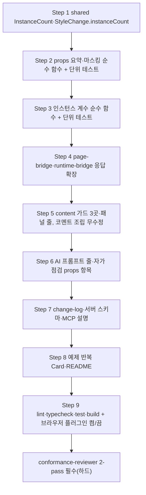

# Plan: 선택 컴포넌트의 props 표시와 화면 렌더 인스턴스 수(수정 영향 범위) 안내
- Intent: [INT-012](intent.md) | Tier: 3 | 작성일: 2026-11-25
- Intent updated_at: 2026-11-25T15:07:52+09:00
- Spec: [spec.md](spec.md)

## 1. Tier 산정
- 판정: Tier 3 (Strict).
  - 변경이 5개 영역에 걸친다: `packages/extension`·`packages/shared`·`packages/server`·`examples/react-vite`·`README.md`.
  - MAIN world 브리지 응답 계약(`packages/extension/src/runtime-bridge.ts:10-27`)과 브리지 호출 분기(`packages/extension/src/content.ts:507`·`:538`·`:565`)가 바뀐다. INT-011 D-S4·NFR-1 회귀 위험이 있다.
  - 공개 계약이 바뀐다: `StyleChange.instanceCount`(`packages/shared/src/types.ts:20-30`), `StyleChangeInputSchema`(`packages/server/src/schema.ts:17-35`), `list_pending_changes` 출력(`packages/server/src/mcp.ts:25-37`). 코멘트 계약(`ScreenComment`·`POST /comments`·`ComponentRuntimeInfoSchema` `schema.ts:64-70`)은 바꾸지 않는다(spec D-S5).
  - 실제 React 19 fiber 트리 계수·props 읽기는 단위 테스트만으로 증명할 수 없어 브라우저 실측이 필수다.
- 하드 게이트 후보: 해당한다. `packages/server/src/mcp.ts`·`schema.ts`는 §A `[배포·계약 자산 경로]`와 경로가 정확히 같지 않지만, 변경 내역 스키마·MCP 출력 변경은 공개 계약 변경이므로 §A 3호②를 적용한다(①도 해당).

## 2. 실행 순서 (Steps)
- Step 1 — 공유 타입 (FR-8, spec §6)
  - 할 일: `packages/shared/src/types.ts`에 `InstanceCount {count, capped}`와 `StyleChange.instanceCount?`(`:20-30`)를 추가한다. `StyleChangeInput`(`:40`)은 `Omit`이라 자동 반영된다. `ScreenComment`(`:68`)·`ComponentRuntimeInfo`(`:92-102`)는 바꾸지 않는다(D-S5).
  - 검증: `pnpm typecheck`. 롤백: 파일 revert.
- Step 2 — props 요약·마스킹 순수 함수 (FR-2~FR-4, E-8~E-10)
  - 할 일: `packages/extension/src/react-runtime.ts` `FiberLike`(`:7-16`)에 `memoizedProps?: unknown`을 추가한다. spec §6 표대로 요약하는 순수 함수(문자열 80자·키 20개/레벨·깊이 2·배열 5개 + `…(+n)`·`[Circular]`·`ƒ name`·`<Tag>`·`[Node tag]`·`[Error]`·전체 1024자·민감 키 `•••`)를 둔다. 파일 분리 여부는 code-planner가 정한다.
  - 검증: `packages/extension/test/react-runtime.test.ts`(또는 신규 테스트 파일)로 AC-1·AC-2. 롤백: 함수·테스트 삭제.
- Step 3 — 인스턴스 계수 순수 함수 (FR-5, E-4~E-7)
  - 할 일: 컴포넌트 fiber의 `type`과 같은 fiber 수를 루트 `current` 트리에서 세고 `{count, capped}`를 돌려주는 함수를 만든다. 방문 상한은 `FIBER_VISIT_LIMIT`(`packages/extension/src/devtools-hook.ts:17`)를 쓰고, 상한 도달 여부를 별도로 반환한다(`findFiberByStateNode` `:20-39`의 `null` 반환 방식과 다름). `FiberLike`에 필요하면 `alternate`·`stateNode` 형태를 보강한다. 루트 탐색은 `return` 체인으로 HostRoot(`tag 3`, `react-runtime.ts:34`)까지 올라가 `stateNode.current`를 쓴다.
  - 검증: 가짜 fiber 단위 테스트(AC-3: 같은 type 수, memo 분리, alternate 입력, 상한 `capped`). `devtools-hook.test.ts` 기존 단언 무수정 통과. 롤백: 함수·테스트 삭제.
- Step 4 — 브리지 응답 확장 (FR-1~FR-5, NFR-3, E-1~E-3·E-13)
  - 할 일:
    - `packages/extension/src/page-bridge.ts:37-60` `respond`에서 `describeRuntime`(`:47`) 결과와 함께 Step 2·3 결과를 `props`·`instanceCount`로 응답한다. DevTools 경로는 hook의 fiber root를 재사용한다. 함수·노드 미포함 원칙(`:53`)을 지킨다.
    - `runtime-bridge.ts` `RuntimeBridgeResult`(`:10-27`)에 두 optional 필드를 추가하고 `isBridgeResult`(`:37`)가 형식 위반 필드만 버리게 한다.
  - 검증: `runtime-bridge.test.ts`(AC-4, `structuredClone` 가능·형식 위반 필드 제거). 롤백: 필드 추가분 revert하면 INT-011 응답으로 복귀한다.
- Step 5 — 선택·패널 통합 (FR-1·FR-6·FR-9, NFR-1, E-2·E-11·E-14·E-15)
  - 할 일:
    - `content.ts:507`·`:538`·`:565` 가드를 바꿔 플러그인 위치가 있어도 브리지를 호출한다. 플러그인 위치가 있으면 응답의 `props`·`instanceCount`만 쓰고 `info`·`hostSource`는 버린다(`:506`·`:564` 주석도 D-03에 맞게 고친다).
    - `#renderSelection`(`:544-559`) → `LocationView`(`panel.ts:14-26`, `:24` 주석 포함)에 두 값을 넘기고 `renderLocation`(`:109-146`)에서 `props:`·`인스턴스:` 줄을 추가한다. 기존 "같은 소스에서 나온 요소 N개"(`:127`·`:136`)는 유지한다.
    - 코멘트 조립(`content.ts:821-829`)은 바꾸지 않는다(FR-9·D-S5 확정: props·instanceCount는 코멘트에 넣지 않는다).
  - 검증: 기존 `source-locator.test.ts` 등 단언 무수정 통과. 코멘트 페이로드에 props·instanceCount가 없는지 확인하는 테스트(AC-8). 롤백: Step 단위 revert.
- Step 6 — AI 프롬프트 (FR-7·FR-12, E-16·E-17)
  - 할 일:
    - `prompt.ts` `PromptSelection`(`:10-17`)에 두 값을 추가하고 `changesPrompt`(`:101`, 삽입 `:128`)·`selectionPrompt`(`:141`, 삽입 `:152`)에 `- props:`·`- 인스턴스:` 줄을 넣는다. `promptInput`(`content.ts:581-598`)이 값을 넘긴다.
    - `- props:` 줄이 1개 이상 출력될 때만 `changesFooter`(`prompt.ts:70`, 호출 `:137`)·`selectionFooter`(`prompt.ts:86`, 호출 `:155`)의 `## 자가 점검` 마지막 항목 뒤에 spec FR-12 확정 문구 1줄을 붙인다. changes 모드는 1번만 붙인다. 시그니처 확장 방식은 code-planner가 정한다.
  - 검증: `prompt.test.ts` 기존 단언(`:202` INT-010 describe 포함) 무수정 + 신규 케이스(AC-6·AC-11: props 있음 → 항목 1번·`## 반영 확인` 앞, props 없음 → 변경 전 출력과 바이트 동일, changes 다건 일부 props → 1번). 롤백: revert.
- Step 7 — 변경 내역 전송·서버 계약·MCP (FR-8, NFR-2, E-12)
  - 할 일:
    - `change-log.ts` `LocalChange`(`:6-13`)에 `instanceCount?`를 추가하고 변경 기록 시점 값을 저장한다. `sendable`(`:51-60`)은 `:56` 구문상 `rest`로 그대로 전송됨을 테스트로 고정한다. props는 넣지 않는다.
    - `schema.ts` `StyleChangeInputSchema`(`:17-35`)에 `instanceCount` optional을 추가한다. `PendingChangeSchema`(`:47-49`) 반영 여부를 확인한다. `ComponentRuntimeInfoSchema`(`:64-70`)는 바꾸지 않는다. `protection.ts:7`은 스프레드라 변경이 없다.
    - `mcp.ts:25-37` `list_pending_changes` 설명에 `instanceCount` 의미를 추가한다.
  - 검증: `change-log.test.ts`(sendable), `server/test/http.integration.test.ts`(AC-7: 있음·없음 200, `list_pending_changes`에 값 유지), `protection.test.ts`·`store.test.ts` 무수정 통과. 롤백: 스키마·타입 줄 revert.
- Step 8 — 예제·README (FR-10·FR-11)
  - 할 일:
    - `examples/react-vite/src/App.tsx`에 Card 반복 렌더(3개 이상)와 민감 키 props(예: `apiToken`) 사용처를 추가하고 `components/Card.tsx` `CardProps`(`:3-8`)를 필요 시 확장한다. 기존 Card(`App.tsx:20-22`)는 유지한다.
    - `README.md` `:257`·`:273`·`:275`·`:294`·`:297`·`:315`를 갱신하고 `:329` 회귀 문구를 "위치·이름 줄은 같고 props·인스턴스 줄만 추가"로 바꾼다. MCP `list_pending_changes` 설명에 `instanceCount`를 추가하고, 코멘트에는 props·인스턴스 수가 실리지 않음을 적는다.
  - 검증: AC-9 문서 대조, `pnpm build`. 롤백: revert.
- Step 9 — 전수 검증
  - 할 일: `pnpm lint`·`pnpm typecheck`·`pnpm test`·`pnpm build`. 브라우저에서 예제를 `DOMIRROR=1 vite`(플러그인 켬)와 `DOMIRROR` 미설정(끔)으로 띄워 AC-5와 콘솔 에러 0건을 확인한다. `ScreenComment`·`ComponentRuntimeInfoSchema` `git diff` 0줄을 확인한다(AC-8).

## 3. Intent 태스크 매핑
- (intent.md에 태스크 미분해) — intent `T-01 [P2] (착수 시 분해 예정)` 1건뿐이다. 착수 시 아래처럼 분해한다.
  - T-01 → Step 1~9 전체
    - props 표시·프롬프트(원 요구 "props 표시·AI 프롬프트 포함"): Step 2·4·5·6
    - 인스턴스 수(원 요구 "동일 컴포넌트 인스턴스 수 표시"): Step 1·3·4·5·6·7
    - 코멘트 미포함 확정(intent.md 20행·51행 정정 각주, spec D-S5): Step 5(조립 무수정·AC-8 테스트)·Step 9(diff 0줄 확인)
    - props 조건부 자가 점검 항목(intent.md 21행, spec FR-12·D-S6, IDEA-20261125-03 ①만 채택): Step 6(AC-11)
    - 예제·문서·검증: Step 8·9
- spec §10 미완료 질문은 0건이다. 추가 Step 없이 Step 1부터 진행한다.
- 단계별 검증 순서: Step 3·5·7이 끝날 때마다 `pnpm test`를 돌리고, Step 5 뒤에 브라우저 부분 확인을 한다.

## 4. 검증 계획 (DoD)
- 단위(vitest, node 환경): AC-1·AC-2·AC-3·AC-4·AC-6·AC-7·AC-8·AC-11. 관련 기존 테스트 `extension/test/{react-runtime,devtools-hook,runtime-bridge,runtime-format,prompt,change-log,source-locator}.test.ts`, `server/test/{protection,store,http.integration}.test.ts`, `plugin/test/react.test.ts`는 단언 수정 없이 통과해야 한다(NFR-1). 현재 테스트 33 파일(근사 356 케이스).
- 정적: `pnpm lint`(oxlint .), `pnpm typecheck`, `pnpm build`(`pnpm -r build`)가 모두 Exit 0.
- 브라우저(Tier 3, `ego-browser` → `Aside MCP` → Playwright 폴백)
  - 대상: macOS Chrome, `examples/react-vite`(React 19.3.1).
  - 시나리오: 플러그인 켬(`DOMIRROR=1 vite`)·끔에서 반복 렌더 Card 내부 요소 선택 → `props:`(민감 키 `•••`)·`인스턴스: N개` 줄, N = 실제 Card 렌더 수, 플러그인 켬의 위치·이름 줄 불변, 프롬프트 복사 결과에 두 줄과 자가 점검 props 항목 포함, 변경 후 `list_pending_changes`에 `instanceCount` 표시(AC-5·AC-7). 콘솔 에러 0건.
- 게이트: 필수(하드) / 근거: ① Tier 3, ② 공개 계약 변경(StyleChange instanceCount·list_pending_changes 출력) / 방식: 2-pass

## 5. 리스크 · 파급
- 문제·영향(intent `## 문제`): DOMirror로 요소를 고르는 개발자와 프롬프트·변경 내역을 소비하는 MCP 에이전트가 대상이다. 실패해도 기존 출력으로 돌아갈 뿐이며 플러그인 사용자에게 위치·이름 회귀가 없어야 한다(NFR-1).
- 제약(intent `## 제약`): NFR-3 직렬화, redaction, D-S4 취지 유지, optional 필드 추가, `TEXT_MAX=2048` 이내, 신규 의존성 금지, React만.
- 결정·폐기 대안: spec §9 D-01~D-06·D-S1~D-S6. 기각한 접근은 3D 레이어 뷰, DOM 기준 인스턴스 계수(`plugin/src/injectors/react.ts:139-143` 부풀림), `ComponentRuntimeInfo.props`(코멘트로 서버 유출), 숫자+불리언 2필드, 코멘트에 props 포함(Q4 일관성 위반·서버 저장 경로, D-S5), IDEA-20261125-03 ②·③ 동시 반영(D-S6)이다.
- 범위 밖: 트리 양방향 선택·라벨 스크린샷(INBOX), production, Vue, props 서버 전송, 코멘트 props·인스턴스 수 포함, IDEA-20261125-03 ②·③(INBOX 유지).
- 핵심 리스크
  - R-1 `fiberFromNode` 경로 루트 접근(추론): Step 3 가짜 fiber + Step 9 실측.
  - R-2 계수 순회의 상한 도달 여부 별도 반환: Step 3 시그니처로 고정.
  - R-3 브리지 분기 3곳·D-S4·README `:329` 충돌: Step 5에서 기존 줄 불변 + 새 줄만 추가, Step 8에서 README 문구 갱신.
  - R-4 zod strip·`satisfies` 미검출: Step 7 통합 테스트.
  - R-5 마스킹 목록 밖 민감값 노출: 로컬 전용 + 코멘트 미포함 + README 한계 명시.
  - R-7 props가 코멘트 페이로드로 새어 들어갈 위험: Step 5 코멘트 조립 무수정 + AC-8 테스트 + Step 9 diff 확인.
  - R-8 changes 모드 props 출처(`LocalChange`에 props 없음): Step 6에서 props 있음·없음 양쪽을 AC-6·AC-11로 검증하고, 없으면 기존 출력과 같아야 한다.
- 미확정: 없음(spec §10 미완료 0건).
- 롤백: Step별 revert 가능. Step 5 가드만 되돌리면 플러그인 경로가 INT-011 동작으로 복귀한다.
- 작업 트리: `docs/intent/INDEX.md`·`_ideas/INBOX.md` 수정분과 INT-012 문서는 구현 커밋과 분리한다.

## 6. 실행 흐름

