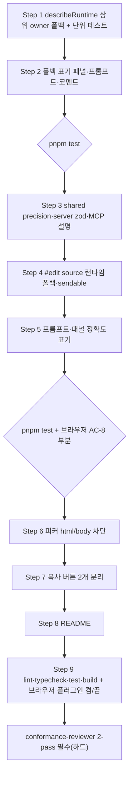

# Plan: CRA·UI 라이브러리 환경 React 런타임 위치 폴백 및 AI 프롬프트 복사 개선
- Intent: [INT-013](intent.md) | Tier: 3 | 작성일: 2026-11-28
- Intent updated_at: 2026-11-28T15:49:19+09:00
- Spec: [spec.md](spec.md)

## 1. Tier 산정
- 판정: Tier 3 (Strict). 근거는 다음 네 가지다.
  - 변경이 4개 영역에 걸친다: `packages/extension`·`packages/shared`·`packages/server`·`README.md`.
  - 공개 계약이 바뀐다.
    - `StyleChange.source.precision`(`packages/shared/src/types.ts:28`)
    - `StyleChangeInputSchema.source`(`packages/server/src/schema.ts:26-32`)
    - `list_pending_changes` 출력·설명
  - 플러그인 우선 가드(`packages/extension/src/content.ts:540`·`:568`)와 INT-011 D-S4가 회귀 위험 지점이다.
  - `content.ts`·`panel.ts`는 단위 테스트가 없다. 그래서 브라우저 검증이 필수다.
- 하드 게이트 후보: 해당한다. 서버 스키마·MCP 출력 변경은 공개 계약 변경이므로 §A 3호②를 적용한다(①도 해당).

## 2. 실행 순서 (Steps)
- Step 1: ① 상위 폴백 순수 로직 (FR-1·FR-2·E-1·E-2)
  - 할 일: `packages/extension/src/react-runtime.ts`를 고친다.
    - `describeRuntime`(`:241-259`)에서 `hostSource`·`callSite`가 `null`이면 `_debugOwner ?? return` 체인(`ownerChain` `:182-196`과 같은 순서)을 올라간다.
    - 올라가면서 `sourceRefFrom`(`:228-233`)의 첫 비-null 값을 쓴다.
    - 상한은 `BRIDGE_OWNER_MAX`, 순환 방지는 `seen`, 종료 조건은 HostRoot다.
    - `normalizeFile`(`:140-168`)·`NOISE_FRAME`(`:53`)은 바꾸지 않는다. E-3 번들 URL 필터가 필요한지만 판단한다.
  - 검증
    - `packages/extension/test/react-runtime.test.ts`에 AC-1 케이스를 추가한다: MUI `node_modules` 호스트, 상위 owner 프로젝트 위치, 전체 `node_modules`, 순환.
    - 기존 describe(`:133`·`:152`·`:176`·`:198`)는 단언을 수정하지 않고 통과해야 한다.
  - 롤백: 함수 revert.
- Step 2: ① 폴백 표기·패널·코멘트 (FR-3·FR-4)
  - 할 일
    - `RuntimeDescription`(`:26-31`)에 내부 필드(초안 `fallbackFrom?: string`)를 추가한다.
    - 브리지 응답(`runtime-bridge.ts`)을 거쳐 `content.ts`로 전달한다.
    - 패널 정의 줄(`panel.ts:111`)과 프롬프트 `componentLines`(`prompt.ts:55-64`)에 폴백 1줄을 표시한다.
    - 공유 `ComponentRuntimeInfo`는 바꾸지 않는다(D-S2).
    - 코멘트 경로(`content.ts:916-922`·`:830-836`)는 `#runtimeHasSource` 결과만으로 동작하게 둔다.
  - 검증: `prompt.test.ts`·`runtime-bridge.test.ts`로 AC-2(폴백 있음은 1줄 추가, 없음은 기존과 같음)를 확인한다.
  - 롤백: 필드와 표기 줄 revert.
- Step 3: ② 공유 타입·서버 계약 (FR-8·NFR-2)
  - 할 일
    - `packages/shared/src/types.ts:28` source에 `precision?: LocationPrecision`을 추가한다(`:89` 재사용).
    - `packages/server/src/schema.ts:26-32`에 `precision: z.enum(['exact','line-unverified']).optional()`을 추가한다.
    - MCP `list_pending_changes` 설명에 spec FR-8 문구를 추가한다.
    - `PendingChangeSchema`에 반영되는지 확인한다.
  - 검증
    - `packages/server/test/http.integration.test.ts`에 AC-4(있음·없음 200, 잘못된 값 400, `list_pending_changes` 값 유지)를 추가한다.
    - `pnpm typecheck`.
  - 롤백: 타입·스키마 줄 revert.
- Step 4: ② `#edit` source 런타임 폴백 (FR-5·FR-6·FR-7·E-4·E-5·E-10)
  - 할 일
    - `content.ts:699`·`:704`에서 `locate(el)`이 `null`일 때만 런타임 위치를 쓴다.
      - 런타임 위치는 `runtimeSourceRefOf` 결과를 `runtimeSourceLocation`(코멘트 경로 `:830-836` 재사용, D-S6)으로 변환한다.
      - source는 `{file, line, column, inherited, precision}`로 채운다. `protected`는 생략한다(D-S4).
    - 런타임 결과가 비동기(`#ensureRuntime` `:539-544`)라 편집 시점에 아직 없을 수 있다. 이때의 처리(대기 또는 캐시 사용)는 code-planner가 확정한다.
    - `change-log.ts`의 `LocalChange`(`:6-13`)는 타입이 자동 반영되는지 확인한다.
    - `sendable`(`:52-60`)은 `precision`이 보존되는지 테스트로 고정한다.
  - 검증: `change-log.test.ts`(sendable `:138`)에 AC-3을 추가한다.
  - 롤백: `#edit` 분기 revert. 플러그인 경로는 원래부터 변경이 없다.
- Step 5: ② 프롬프트·패널 정확도 표기 (FR-9)
  - 할 일
    - `prompt.ts:148` `where(c.source)` 결과에 `precision` 표기를 붙인다. `runtime-format.ts:13` 상수를 재사용한다.
    - `panel.ts:323-326` 변경 항목에도 같은 표기를 붙인다.
    - `precision`이 없으면 출력이 바뀌지 않아야 한다.
  - 검증: `prompt.test.ts`로 AC-5(바이트 동일 단언 포함)를 확인한다.
  - 롤백: revert.
- Step 6: ③ 피커 `html`/`body` 차단 (FR-10·FR-11·E-8·E-9)
  - 할 일
    - `picker.ts:7` `BlockedReason`에 `'root-element'`를 추가한다.
    - 차단 판정 순수 함수를 둔다(`frameBlockedReason` `:58-61` 패턴).
    - `onClick`(`:133-141`)과 `onPointerMove`(`:110-115`)에 적용한다.
    - `content.ts`의 `onBlocked` 안내에 FR-11 문구를 추가한다.
  - 검증: `picker.test.ts`(`:4`)에 AC-6을 추가한다.
  - 롤백: revert.
- Step 7: ③ 복사 버튼 2개 분리 (FR-12·FR-13·E-6·E-7)
  - 할 일
    - `content.ts:215-217` 버튼을 `선택 요소 복사`·`변경 내역 복사`로 나눈다.
    - `promptInput`(`:598-620`)을 모드별 2개로 나눈다(`:599` 분기 제거).
    - `onCopy`(`:328-347`)를 모드별로 나누고, 위치 미확인 N건(`:339-340`)은 변경 내역에만 둔다.
    - 이벤트 등록(`:382`)·해제(`:401`)는 두 버튼 모두에 적용한다.
    - 선택·내역 상태가 바뀔 때 활성 여부를 갱신한다.
  - 검증: 입력 생성 함수를 순수 함수로 분리할 수 있으면 단위 테스트한다. 나머지는 Step 9 AC-7에서 확인한다.
  - 롤백: revert.
- Step 8: 문서 (FR-14)
  - 할 일: `README.md`의 사용법·한계 절을 갱신한다. 내용은 폴백, `precision`, `line-unverified` 오차 안내(INT-011 result.md:53: −7~+27행), `html`/`body` 차단, 버튼 2개다.
  - 검증: AC-12 문서 대조. 롤백: revert.
- Step 9: 전수 검증 (AC-7~AC-11)
  - 할 일
    - `pnpm lint`·`pnpm typecheck`·`pnpm test`·`pnpm build`를 돌린다.
    - 익스텐션을 빌드한 뒤 `examples/react-vite`로 다음을 확인한다.
      - 플러그인 끔(`DOMIRROR` 미설정): AC-7·AC-8·AC-9
      - 플러그인 켬(`DOMIRROR=1`): AC-10
    - 콘솔 에러 0건을 확인한다.
    - 선택 사항: 사용자가 `빅스_프론트`(`http://localhost:3000/home`)를 띄워 두었다면, `MainMenuView > Tooltip > Typography > MuiTypographyRoot`를 관찰 전용으로 실측한다(대상 저장소 수정 금지).

## 3. Intent 태스크 매핑
- (intent.md에 태스크 미분해) intent에는 `T-01 [P2] (착수 시 분해 예정)` 1건만 있다. 착수 시 intent Q4 순서(①→②→③)대로 아래처럼 분해한다.
  - ① 라이브러리 상위 사용자 컴포넌트 폴백: Step 1·2. 끝나면 `pnpm test`를 돌린다.
  - ② CSS 변경 런타임 위치 폴백: Step 3·4·5. 끝나면 `pnpm test`를 돌리고 브라우저에서 AC-8을 부분 확인한다.
  - ③ `html`/`body` 가드·프롬프트 복사 UX: Step 6·7. 끝나면 `pnpm test`를 돌린다.
  - 문서·전수 검증: Step 8·9.
- spec §10의 미완료 질문은 0건이다. 추가 Step 없이 Step 1부터 진행한다.

## 4. 검증 계획 (DoD)
- 단위(vitest)
  - 신규 AC: AC-1~AC-6.
  - 기존 테스트 `extension/test/{react-runtime,runtime-bridge,runtime-format,runtime-inspect,prompt,change-log,picker,source-locator,comment-log}.test.ts`와 `server/test/http.integration.test.ts`는 단언을 수정하지 않고 통과해야 한다(NFR-1·NFR-2).
- 정적: `pnpm lint`(`oxlint .`)·`pnpm typecheck`·`pnpm build`(`pnpm -r build`)가 모두 Exit 0.
- 브라우저(Tier 3, `ego-browser` → `Aside MCP` → Playwright 폴백)
  - 환경: macOS Chrome, `examples/react-vite`, 플러그인 켬과 끔 두 가지.
  - 시나리오: AC-7~AC-10. 콘솔 에러 0건.
  - 대상 환경(CRA `react-scripts` 5.0.1 + React 18.2.0 + MUI)은 저장소에 없다. 사용자 앱을 관찰할 수 있을 때만 선택적으로 실측하고, 미수행이면 사유를 보고한다(spec R-1).
- 게이트: 필수(하드) / 근거: ① Tier 3, ② 공개 계약 변경(StyleChange.source.precision·POST /changes 스키마·list_pending_changes 출력) / 방식: 2-pass

## 5. 리스크 · 파급
- 문제·영향(intent `## 문제`): 대상은 CRA/Webpack + UI 라이브러리 React dev 앱 개발자와, 변경·코멘트를 소비하는 MCP AI 에이전트다. 플러그인 사용자에게는 회귀가 없어야 한다(NFR-1).
- 제약(intent `## 제약`)
  - 플러그인 우선 원칙을 지킨다.
  - React dev 빌드만 대상으로 한다.
  - 계약 변경은 하위 호환 선택 필드로만 한다.
  - 일정·보안 제약은 미확정이다(intent 32행).
- 결정·폐기 대안(spec §9)
  - D-01·D-02·Q1~Q4·D-S1~D-S6을 따른다.
  - 기각한 접근은 다음과 같다.
    - 3개 intent 분리
    - CRA `craco`와 Webpack/Babel 어댑터
    - `return` 체인만 쓰는 상위 탐색
    - `ComponentRuntimeInfo.fallbackFrom`
    - `component.precision`만으로 추론
    - 잔류 `html`/`body` 자동 정리
- 범위 밖: 빌드 플러그인 어댑터, `빅스_프론트` 수정, Vue, production, 소스맵 라인 보정, 코멘트 계약 변경.
- 핵심 리스크
  - R-1 대상 환경 부재: Step 1의 가짜 fiber(React 18 `_debugSource` 형태)로 재현하고, Step 9에서 선택적으로 실측한다.
  - R-2 React 19 + Webpack 번들 URL 오인: Step 1에서 판단하고 필요하면 필터와 테스트를 추가한다.
  - R-3 `line-unverified` 라인 오차로 AI가 잘못 수정할 위험: Step 3 MCP 설명과 Step 5 프롬프트 표기로 안내한다.
  - R-4 zod strip으로 `precision`이 사라질 위험: Step 3 통합 테스트로 막는다.
  - R-5 `content.ts`·`panel.ts`에 단위 테스트가 없음: Step 7에서 순수 함수로 분리하고 Step 9 브라우저로 검증한다.
  - R-6 플러그인 가드 회귀: Step 4는 `locate(el) === null` 분기에만 추가하고, Step 9 AC-10으로 확인한다.
- 롤백: Step별로 revert할 수 있다. Step 3을 되돌리면 Step 4·5도 함께 되돌린다(타입 의존).
- 작업 트리: `docs/intent/INDEX.md`와 INT-003 문서 수정분은 구현 커밋과 분리한다.

## 6. 실행 흐름

