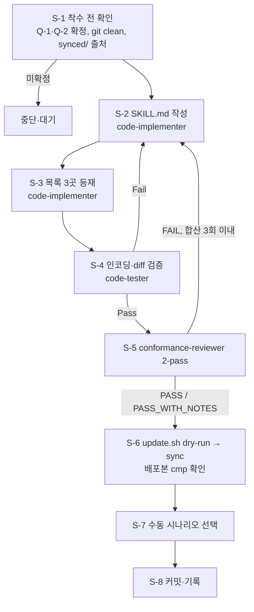

# Plan: zAgentSet용 DOMirror 스킬·서브에이전트 연동
- Intent: [INT-003](intent.md) | Tier: 2 | 작성일: 2026-11-17
- Intent updated_at: 2026-11-17T15:48:19+09:00
- Spec: [spec.md](spec.md)

## 1. Tier 산정
- **Tier 2 (Standard)**
  - 근거: 프롬프트 전용 신규 스킬 1개와 목록 3곳 등재로, 마크다운 4파일이다. 실행 스크립트·설정 변경은 0건이다.
  - 다만 스킬 동작 계약(위임·대조 규칙)을 새로 정의하므로 Tier 1(자명 변경)은 아니다.
  - 전역 영향(기존 스킬·sync 로직 변경)이 없어 Tier 3도 아니다.
- 게이트는 Tier와 별개다. `src/skills/`는 `[배포·계약 자산 경로]`이고 신규 스킬은 실질 규칙 추가이므로 §A 3호② `필수(하드)`가 Tier보다 우선한다.
- 실행 저장소는 `/Users/dev-juhee/dev-Joy/zAgentSet`이다. DOMirror 저장소의 코드 변경은 0건이다.

## 2. 실행 순서 (Steps)
| Step | 내용 | 담당 | 검증 | 롤백 |
| :--- | :--- | :--- | :--- | :--- |
| S-1 | 착수 전 확인: spec §10 Q-1·Q-2가 확정되었는지, zAgentSet `git status`가 clean인지, `~/.zAgentSet/skills/synced/`의 출처를 확인한다(R-3). | 오케스트레이터 | 확인 결과 1줄씩 기록 | 해당 없음 |
| S-2 | `src/templates/skill/SKILL.md`를 기준으로 `src/skills/z_skill_domirror/SKILL.md`를 작성한다(spec FR-1~FR-7, E-1~E-9, NFR-3). | code-implementer | AC-1·AC-2 | 디렉터리 삭제 |
| S-3 | 목록 3곳에 등재한다. 각 위치에 기존 형식대로 1행씩 추가한다(FR-8). | code-implementer | AC-3 | `git checkout -- <파일>` |
| S-4 | 인코딩·diff 범위를 검증한다(NFR-1·NFR-4). | code-tester | AC-4·AC-6 | S-2·S-3으로 회귀 |
| S-5 | 정합성 게이트 2-pass를 실행한다(§4). | conformance-reviewer | PASS / 근거 있는 PASS_WITH_NOTES | 지적 항목 S-2·S-3 회귀(합산 3회) |
| S-6 | 배포: zAgentSet 루트에서 `./update.sh --dry-run` → `./update.sh`를 실행하고 배포본을 대조한다(FR-9). | code-tester(검증) / 오케스트레이터(실행 로그 기록) | AC-5 | 원본 되돌림 후 `./update.sh` 재실행 |
| S-7 | (선택) DOMirror 서버 기동 상태에서 수동 시나리오를 확인한다. | 사용자/code-tester | AC-7 | 해당 없음 |
| S-8 | 커밋: zAgentSet은 `z_skill_git_commit`으로 커밋한다(메시지에 `DOMirror INT-003` 표기). DOMirror는 intent 진행 기록과 `docs/works/`를 남긴다. | 오케스트레이터 | 커밋 해시 기록 | `git revert` |

- S-2 대상: `src/skills/z_skill_domirror/SKILL.md`. frontmatter는 `name`과 작은따옴표 `description` 2필드다. 본문 절차는 다음 순서다.
  - 사전 점검
  - `list_pending_changes`
  - 파일별 요약 표
  - `code-implementer` 위임(대조 규칙)
  - `code-tester` 위임
  - applied id만 `mark_changes_applied`
  - 보고
- S-3 등재 위치
  - `src/skills/README.md` 「3. 기본 제공 스킬 목록」 표(`:57-76`): 표 행 1개 추가.
  - `AGENTS.md` §3 트리(`:61-78`): 트리 줄 1개 추가.
  - `README.md` 트리(`:125-145`): 트리 줄 1개 추가.
- S-4 명령
  - `head -c3 <file> | xxd`: `efbbbf` 0건이어야 한다.
  - `grep -c $'\r' <file>`: 0이어야 한다.
  - `git diff --stat`: 변경이 4파일에 한정되어야 한다.
- S-6 확인 명령
  - `cmp src/skills/z_skill_domirror/SKILL.md ~/.zAgentSet/skills/z_skill_domirror/SKILL.md`
  - `ls ~/.claude/skills/z_skill_domirror/`

## 3. Intent 태스크 매핑
| Intent 태스크 | Plan Step | 비고 |
| :--- | :--- | :--- |
| T-01 [P2] (착수 시 분해 예정) | S-1 ~ S-8 | 착수 시 intent-manager가 T-01을 다음으로 분해할 것을 권장한다. ① SKILL.md 작성(S-2) ② 목록 등재(S-3) ③ 검증·게이트(S-4·S-5) ④ 배포·커밋(S-6·S-8) |

## 4. 검증 계획 (DoD)
- 게이트: 필수(하드) / 근거: ② `[배포·계약 자산 경로]`(`zAgentSet/src/skills/`) 실질 규칙 추가 / 방식: 2-pass
- Tier 2 완료 조건
  - 코드 테스트: 타겟 검증 AC-1~AC-4, AC-6 통과. 단위 테스트 대상 코드는 없다(프롬프트 전용).
  - zAgentSet `AGENTS.md:119` §5.1 추가 검증: 인코딩 검사와 sync 전역 반영 확인(AC-5).
  - 정합성 게이트: `conformance-reviewer` 2-pass가 `PASS`이거나, 비차단 근거가 1줄 기재된 `PASS_WITH_NOTES`여야 완료 보고와 `done` 전이를 할 수 있다.
  - AC-7(수동 시나리오)은 선택이다. 미수행 시 완료 보고에 `미수행: AC-7(수동) — 사유` 1줄을 남긴다.
- 대조 입력: 이 spec.md(FR-1~FR-9, AC-1~AC-7), zAgentSet `src/skills/README.md:16-28`(형식·description 규칙), `AGENTS.md:39`(인코딩).

## 5. 리스크 · 파급
- R-1 zAgentSet 측 게이트 해석: §10 Q-1이 미확정이면 S-1에서 중단한다.
- R-2 대조 품질: 불일치 시 skip을 기본값으로 한다(spec FR-4·E-5). 잘못된 반영은 `code-tester`·사용자 리뷰로 차단한다.
- R-3 sync prune: S-1에서 `~/.zAgentSet/skills/synced/`의 출처를 확인한 뒤 S-6을 실행한다. 판단이 모호하면 `--dry-run` 출력으로 prune 대상을 확인한다.
- R-4 파급 범위
  - 배포 후 zAgentSet을 쓰는 모든 하네스(claude-code 등 `config/harnesses.json`의 skills 링크 대상)에 스킬이 노출된다. 기존 스킬 동작에는 영향이 없다.
  - DOMirror 코드·계약 영향은 0건이다.
- 관련: INT-007(수정 금지 영역 경고)과는 독립적이다. 추후 INT-007 구현 시 이 스킬의 반영 단계에 경고를 연계할 수 있다.

## 6. 실행 흐름

