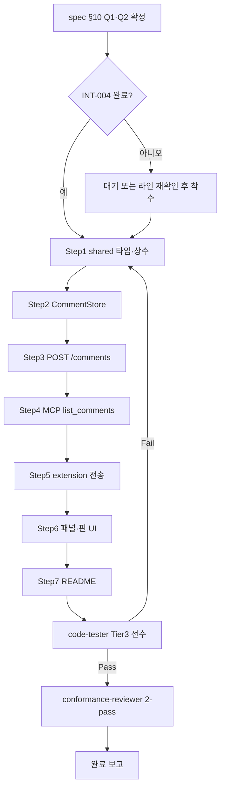

# Plan: 화면 위 코멘트 작성과 GitHub Issues·Slack 연동
- Intent: [INT-005](intent.md) | Tier: 3 | 작성일: 2026-11-17
- Intent updated_at: 2026-11-17T15:57:18+09:00
- Spec: [spec.md](spec.md)

## 1. Tier 산정
- Tier 3 (Strict). shared·server·extension 세 패키지를 함께 바꾸고, 로컬 서버에 HTTP 경로(`POST /comments`)와 MCP 도구(`list_comments`)를 추가한다. 이는 공개 계약 확장이며 보안 경계(Host·Origin 검증, `README.md:255`~`:257`) 위의 새 입력 표면이다. 프런트엔드(페이지 위 핀) 변경이 있어 브라우저 검증이 필요하다.
- 하드 게이트 후보: 아님(`[배포·계약 자산 경로]` 해당 없음). 다만 공개 계약(MCP 툴·HTTP 경로) 변경으로 §A 3호 ②가 적용된다.
- intent D-01(P2)·D-02(별도 intent 진행)를 따른다. 착수 전 spec §10 Q1·Q2 확정이 필요하다.

## 2. 실행 순서 (Steps)
1. shared 타입·상수 — `packages/shared/src/types.ts`에 `ScreenComment`·`ScreenCommentInput`·`PostCommentsRequest`·`PostCommentsResponse`·`ContentToWorkerCommentsMessage`, `constants.ts`에 `COMMENTS_PATH` 추가(spec §6). 검증: `pnpm typecheck`. 롤백: 두 파일 `git checkout`.
2. server 저장소 — `packages/server/src/comment-store.ts` `CommentStore`(upsert·list·500건 상한, Q2=B면 `markResolved`) + `packages/server/test/comment-store.test.ts`. 검증: `pnpm test`(AC-3). 롤백: 새 파일 삭제.
3. server 스키마·라우트 — `schema.ts`에 `ScreenCommentInputSchema`·`PostCommentsRequestSchema`(D-S3 상한), `http.ts`에 `POST /comments` 분기(`handlePostChanges` `:68` 처리 순서 재사용), `createHttpServer` opts에 `commentStore`, `cli.ts:37` 주입. 검증: 통합 테스트 AC-1·AC-2. 롤백: 세 파일 `git checkout`.
4. MCP 도구 — `mcp.ts`에 `list_comments`(Q2=B면 `mark_comments_resolved`), `createMcpFactory` 인자 확장. `http.integration.test.ts:82` 툴 목록 단언 갱신. 검증: AC-1·AC-4. 롤백: `git checkout`.
5. extension 전송 — `relay.ts`에 `postComments`(`postChanges` `:29` 내부 재사용), `service-worker.ts`에 `isSendCommentsMessage` 가드와 `onMessage` 분기. 단위 테스트 추가. 검증: AC-5. 롤백: `git checkout`.
6. extension UI — `panel.ts`에 코멘트 입력·목록 렌더(`textContent`만), 핀 렌더(`createSelectionHighlight` `:205` 방식, 단일 rAF 루프), `content.ts`의 `createPanel` 슬롯·`select` 흐름 연결. Q1=A면 `storage.ts`에 `commentsKey(origin)` 추가와 activate 시 복원. 검증: `pnpm build`·AC-6 브라우저 실측. 롤백: `git checkout`.
7. README — 사용법·MCP 도구 목록·보안·운영 섹션 갱신(FR-9). 검증: AC-8 `rg -n "list_comments|/comments" README.md`. 롤백: `git checkout README.md`.

## 3. Intent 태스크 매핑
- intent `T-01 [P2] (착수 시 분해 예정)` → 착수 시 아래처럼 분해를 권장한다(intent.md 수정은 착수 시 `intent-manager`가 수행).
  - T-01 shared 타입·상수 (Step 1)
  - T-02 server 저장소·라우트 (Step 2~3)
  - T-03 MCP 도구 (Step 4)
  - T-04 extension 전송 (Step 5)
  - T-05 extension 작성 UI·핀 표시 (Step 6)
  - T-06 README·종단 검증 (Step 7, AC-6·AC-7)
- 인계 지시(intent): spec §10 Q1·Q2 확정 후 구현 착수(사용자 명시 지시 필요).

## 4. 검증 계획 (DoD)
- code-tester(Tier 3, 전수):
  - `pnpm lint`(oxlint)·`pnpm typecheck`·`pnpm test`(vitest)·`pnpm build` Exit 0
  - AC-1~AC-5 자동 테스트, AC-3 상한 경계(500·501건)
  - AC-6 브라우저 실측: `examples/react-vite` + `node packages/server/dist/cli.js` + 빌드한 익스텐션. 도구 순서 `ego-browser → Aside MCP → Playwright`, 콘솔 에러 0건
  - AC-7: `git diff --stat -- packages/extension/manifest.json`(0줄), `rg -nP "https?://(?!127\.0\.0\.1)" packages/*/src`(0건)
  - 신규·수정 파일 CR 0건·BOM 없음
- 브라우저 도구가 모두 불가하면 AC-6 미수행 사유를 보고하고 수동 체크리스트를 README가 아닌 완료 보고에 남긴다.
- 게이트: 필수(하드) / 근거: ① Tier 3, ② 공개 계약 변경(HTTP `POST /comments`·MCP `list_comments` 추가) / 방식: 2-pass

## 5. 리스크 · 파급
- INT-004 충돌(spec R-1): `panel.ts`·`picker.ts`·`content.ts`(95·268~273행)·`shared/constants.ts`를 함께 건드린다. INT-004 완료 후 착수하고, 착수 직전 spec §3의 `content.ts` 라인을 재확인한다.
- INT-006 공유 영역(spec R-2): `panel.ts:158` `renderChanges`. 패널 슬롯 추가 시 순서 충돌만 주의.
- 기존 MCP 계약: 툴 추가만 하고 기존 두 도구 입출력은 무변경(NFR-5). 통합 테스트 `:82` 단언만 갱신.
- 보안: 새 경로가 Host·Origin 검증 뒤에 오는지(`http.ts:99`·`:100` 이후 분기) 2-pass에서 확인. 외부 호출 0건·자격 증명 0건(NFR-3).
- 범위 밖 유지: GitHub Issues·Slack·스크린샷·자동 수정·실시간 공유(spec §2). 후속은 별도 intent 또는 이 intent 재개로 다룬다.
- 재시작 소실(`README.md:264`)은 허용된 제약이다(미해결 질문 5 답변).

## 6. 실행 흐름

