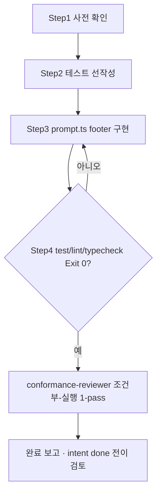

# Plan: AI 프롬프트에 자가 점검 목록·반영 결과 확인 단계 추가
- Intent: [INT-010](intent.md) | Tier: 2 | 작성일: 2026-11-18
- Intent updated_at: 2026-11-17T23:54:18+09:00
- Spec: [spec.md](spec.md)

## 1. Tier 산정
- 판정: Tier 2 (Standard).
  - 변경 파일은 `packages/extension/src/prompt.ts`와 `packages/extension/test/prompt.test.ts` 2개이고 단일 패키지 안에 머문다.
  - 사용자에게 보이는 출력(클립보드 프롬프트)이 바뀌고 intent가 단위 테스트 갱신·추가를 요구한다. 그래서 Tier 1(로직 영향 0 정적 상수)을 넘는다.
  - 서버·MCP 계약, 브레이킹 체인지, 전역 구조 변경이 없으므로 Tier 3에는 미달한다.
  - 브라우저 실측은 필요 없다. 출력은 순수 함수 문자열이라 단위 테스트로 검증한다.
- 하드 게이트 후보: 아님. `packages/extension/**`는 `[배포·계약 자산 경로]`가 아니고 공개 계약 변경도 0건이다.

## 2. 실행 순서 (Steps)
1. 사전 확인
   - 내용
     - `git status`로 작업 트리를 확인한다. 무관한 미추적 `INT-009` 폴더를 커밋에 섞지 않는다(spec R-4).
     - spec §3 `경로:라인`을 HEAD `0bb4c00` 기준으로 재확인한다(원 요구: demolab 기법 채택, 선택 A).
     - `README.md`에 프롬프트 구성 설명이 있는지 `rg -n "AI 프롬프트" README.md`로 확인하고, 있으면 후속 작업으로 보고만 한다(spec R-3).
     - 재현: 익스텐션 패널 `AI 프롬프트 복사` 출력에 점검·확인 섹션이 없다(macOS Darwin 25.6.0, Chrome MV3).
   - 검증: 인용 줄 발췌 일치.
   - 롤백: 해당 없음(읽기).
2. 테스트 선작성 (FR-6, AC-1~AC-4)
   - 내용: `prompt.test.ts`에 새 `describe`를 추가한다.
     - 내역 2건: `## 자가 점검`·`## 반영 확인` 각 1회, 순서(마지막 항목 뒤 → 자가 점검 → 반영 확인), 항목 수 `2` 포함.
     - 반영 확인에 `chrome-devtools-mcp`·`별도 브라우저`·`!important`·`새로고침` 포함.
     - 선택 모드(위치 있음·없음): 두 섹션 존재, `새로고침` 포함, `after` 비교 문구 없음.
     - 빈 내역: `## 자가 점검` 없음.
   - 검증: `pnpm vitest run packages/extension/test/prompt.test.ts`에서 새 테스트만 실패한다.
   - 롤백: 추가 블록 삭제.
3. `prompt.ts` 구현 (FR-1~FR-5, D-S1~D-S4)
   - 내용
     - 모듈 내부 헬퍼 `changesFooter(count)`·`selectionFooter()`를 추가한다(spec §6 출력 예 기준).
     - `changesPrompt`: `changes.length > 0`일 때만 `:88` 반환 전에 footer 줄을 push한다.
     - `selectionPrompt`: `:103` 뒤에 footer 줄을 펼쳐 넣는다.
     - 새 문구에 spec NFR-4 금지 문자열을 쓰지 않는다. 헤더는 `## `다.
     - 순수 함수를 유지한다(`:6`).
   - 검증: Step 2 테스트와 기존 테스트 전부 통과(AC-5, 기존 단언 수정 0건).
   - 롤백: 파일 `git checkout`.
4. 전체 검증
   - 내용: 루트에서 `pnpm test`·`pnpm lint`·`pnpm typecheck`를 실행한다.
   - 검증: Exit 0(AC-6). 변경 파일이 LF·UTF-8인지 확인한다.
   - 롤백: 실패 시 Step 3으로 회귀한다.

## 3. Intent 태스크 매핑
- intent의 `T-01 [P2] (착수 시 분해 예정)` → Step 1~4 전체.
- 착수(`planned`→`active`) 시 `intent-manager`가 아래처럼 분해하도록 권고한다.
  - T-01 프롬프트 말미 섹션 구현: Step 2~3
  - T-02 전체 검증: Step 4
- 인계 지시 "다음 단계는 `z_skill_intent_to_specplan`"은 이번 산출로 충족했다. 다음은 사용자 명시 지시 후 구현 파이프라인이다.

## 4. 검증 계획 (DoD)
- 단위(vitest): AC-1~AC-5. 대상은 `packages/extension/test/prompt.test.ts`이며 기존 테스트가 단언 수정 없이 전부 통과해야 한다.
- 정적: `pnpm lint`(oxlint .), `pnpm typecheck`가 Exit 0이어야 한다.
- 브라우저: 생략. 출력이 순수 함수 문자열이라 단위 테스트로 충분하다. 원하면 수동으로 패널 `AI 프롬프트 복사` 결과를 붙여넣어 확인한다.
- 게이트: 조건부-실행 / 근거: 저위험 조건 ③(FR 6건+AC 6건 >3) 미충족 / 방식: 1-pass

## 5. 리스크 · 파급
- 문제·영향: 구현 에이전트가 과잉 수정·누락을 스스로 검출할 기준이 없는 문제(intent `## 문제`)를 해소한다. 파급은 클립보드 프롬프트 텍스트에 한정된다.
- 제약·불변
  - 최소 변경: 기존 머리·항목 문구와 순서를 유지하고 말미만 추가한다.
  - 신규 의존성 0건, MCP 서버 도구 계약 변경 0건.
  - `buildPrompt` 시그니처·호출처(`content.ts:287`) 변경 0건.
- 결정·폐기 대안
  - D-01: 스킬 패키징·멀티 호스트 매니페스트, CSS 편집 경고는 폐기했다.
  - D-02: demolab 원문은 복사하지 않는다.
  - D-S1: 빈 내역에도 붙이는 안은 폐기했다.
  - D-S2: `#### ` 헤더·굵은 글씨 라벨은 폐기했다.
- 범위 밖: 디자인 생성 규칙, 서버·플러그인 변경, INT-008 인라인 값 해제, README 수정.
- 리스크와 대응
  - R-1 프롬프트 길이 증가: 섹션당 3줄 안팎으로 유지한다.
  - R-2 도구 부재 시 사용자 수동 확인: 의도된 폴백이다.
  - R-3 README와의 불일치 가능성: Step 1에서 확인해 후속으로 보고한다.
  - R-4 무관한 미추적 폴더: Step 1에서 확인하고 커밋에서 제외한다.
- 미확정: 없음. spec §10은 모두 `[x]`이며 D-S1~D-S4는 권장안 확정이고 이의가 있으면 갱신한다.

## 6. 실행 흐름

