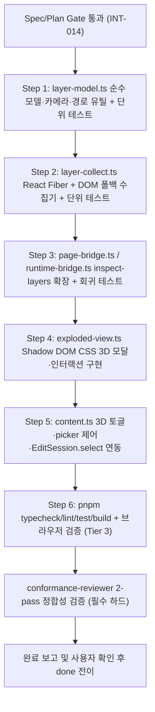

# Plan: 3D 컴포넌트 레이어 분해도(Exploded 3D Layers) 시각화 및 편집 연동
- Intent: [INT-014](intent.md) | Tier: 3 | 작성일: 2026-11-28
- Intent updated_at: 2026-11-28T16:19:25+09:00
- Spec: [spec.md](spec.md)

## 1. Tier 산정
- **선정 등급**: **Tier 3 (Strict)**
- **산정 근거**:
  1. Chrome Extension 프론트엔드에 신규 인터랙티브 3D 시각화 모달(`exploded-view.ts`)과 MAIN↔ISOLATED world 브리지 프로토콜 확장(`inspect-layers`)을 도입하는 주요 기능 추가다.
  2. `content.ts`, `page-bridge.ts`, `runtime-bridge.ts` 등 핵심 진입·통신 모듈을 수정하며, `picker`·`EditSession`·Shadow DOM z-index 라이프사이클과 상호작용한다.
  3. CSS 3D 렌더링, 드래그 회전/줌/깊이 슬라이더, Pick-to-Inspect 편집 연동의 실제 동작은 단위 테스트만으로 입증할 수 없으며 **전체 빌드·정적 분석·단위 테스트 + 브라우저 실동작 검증(콘솔 에러 0건, 정상 렌더링)**이 필수다.

## 2. 실행 순서 (Steps)
> 환경 기준: macOS / Node.js `>=22.12` / `pnpm@10.26.1` / Chrome Manifest V3 / React DOM `v18.2~v19.3`

### Step 1: 순수 3D 레이어 모델·카메라·경로 유틸 구현 (`layer-model.ts`)
- **대상 파일**: `packages/extension/src/layer-model.ts` (신규), `packages/extension/test/layer-model.test.ts` (신규)
- **작업 내용**:
  - `LayerNode`, `LayerSnapshot`, `CameraState`, `DEFAULT_CAMERA` 타입·상수 정의 (`spec.md` §6.2)
  - 카메라 상태 클램핑(`clampCamera`: `rotateX [-85, 85]`, `rotateY [-180, 180]`, `scale [0.3, 2.5]`, `spacing [0, 80]`)
  - 레이어 가시성 필터링, 깊이(0-based) 정규화, 최대 `150`개 상한 절단(`truncated` 플래그) 순수 함수 구현
  - `domPath` 생성/역조회 순수 헬퍼(`buildDomPath`, `resolveDomPath`) 구현
- **검증**: `pnpm test` (`layer-model.test.ts` 통과) + `pnpm typecheck`
- **롤백**: 신규 2개 파일 삭제

### Step 2: React Fiber 및 비-React DOM 폴백 레이어 수집기 구현 (`layer-collect.ts`)
- **대상 파일**: `packages/extension/src/layer-collect.ts` (신규), `packages/extension/test/layer-collect.test.ts` (신규)
- **작업 내용**:
  - MAIN world용 `collectFiberLayers(doc, maxLayers)`: `devtools-hook.ts` / `react-runtime.ts:63-78` (`fiberFromNode`) + `instance-count.ts:13-25` (`currentTreeRoot`) + `COMPONENT_TAGS`(`react-runtime.ts:43-49`)를 재사용해 `FIBER_VISIT_LIMIT = 20_000` 상한 내 컴포넌트 계층과 대표 호스트 DOM의 `rect`·`domPath` 수집
  - ISOLATED world용 `collectDomFallbackLayers(doc, maxLayers, isExcluded)`: `<domirror-panel>` 및 iframe/비가시 요소를 제외하고 일반 DOM 구조 레이어 수집
- **검증**: `pnpm test` (`layer-collect.test.ts` — 가짜 Fiber/DOM 픽스처로 React 모드·폴백 모드·상한 절단 검증)
- **롤백**: 신규 2개 파일 삭제

### Step 3: MAIN↔ISOLATED 브리지 `inspect-layers` 프로토콜 확장
- **대상 파일**: `packages/extension/src/page-bridge.ts`, `packages/extension/src/runtime-bridge.ts`, `packages/extension/test/runtime-bridge.test.ts`
- **작업 내용**:
  - `page-bridge.ts:7-52`: `isBridgeRequest`에 `type === 'inspect-layers'` 분기 추가, `collectFiberLayers` 호출 후 `type: 'inspect-layers:result'` 응답 송신(기존 `inspect` 경로 무변경)
  - `runtime-bridge.ts:13-124`: 기존 `requestRuntimeInfo`와 격리된 `requestLayerSnapshot(maxLayers, timeoutMs = 500)` 추가(화이트리스트 응답 검증, 타임아웃 시 `null` 반환)
- **검증**: `pnpm test` (`runtime-bridge.test.ts` 기존 테스트 회귀 + 신규 `inspect-layers`·타임아웃·기존 `inspect` 비간섭 테스트 통과)
- **롤백**: `git checkout -- packages/extension/src/page-bridge.ts packages/extension/src/runtime-bridge.ts packages/extension/test/runtime-bridge.test.ts`

### Step 4: Shadow DOM 3D 분해도 오버레이/모달 UI 구현 (`exploded-view.ts`)
- **대상 파일**: `packages/extension/src/exploded-view.ts` (신규)
- **작업 내용**:
  - `EXPLODED_VIEW_CSS` 정의: Shadow DOM 내부 전체 화면 백드롭(`z-index: 2147483647`), 상단 컨트롤 바(모드 배지 `React Fiber`/`DOM Fallback`, `truncated` 안내, 깊이 간격 슬라이더, `+/-` 줌, `Reset`, `Refresh`, 닫기), 3D 스테이지(`perspective`, `transform-style: preserve-3d`), 깊이별 와이어프레임·라벨 레이어 카드 및 호버 툴팁
  - `createExplodedView(options)` 구현: 포인터 드래그 회전(이동 거리 `> 4px` 시 클릭 억제), 휠 줌, `Escape` 닫기, 카드 클릭 시 `resolveDomPath` + `elementBlockedReason`(`picker.ts:67-73`) 확인 후 `onPickElement(el)` 호출, `dispose()` 완전 정리
- **검증**: `pnpm typecheck` + `pnpm lint` + `pnpm build`
- **롤백**: 신규 파일 삭제

### Step 5: `<domirror-panel>` 진입점 및 `EditSession`·`picker` 연동 (`content.ts`)
- **대상 파일**: `packages/extension/src/content.ts` (`:100-121`, `:182-243`, `:970-1021` 최소 수정)
- **작업 내용**:
  - `adoptedStyleSheets`에 `EXPLODED_VIEW_CSS` 결합(`content.ts:185-187`)
  - 패널 상단/컨트롤 영역에 `3D 레이어` 토글 버튼 추가
  - `activate()`(`content.ts:975-1010`)에서 `createExplodedView` 생성:
    - `collectLayers`: `requestLayerSnapshot()` 우선 호출 → 결과 `null` 또는 0건이면 `collectDomFallbackLayers()` 폴백
    - `onOpenChange(open)`: 열릴 때 `picker.stop()`, 닫힐 때 `picker.start()`
    - `onPickElement(el)`: `explodedView.close()` 후 `session.select(el)` 호출(기존 CSS 편집·코멘트·프롬프트 복사·MCP 전송 흐름 자동 연결)
  - `deactivate()`(`content.ts:1012-1021`)에 `explodedView?.dispose()` 추가
- **검증**: `pnpm build && pnpm lint && pnpm typecheck && pnpm test`
- **롤백**: `git checkout -- packages/extension/src/content.ts`

### Step 6: 통합 빌드·정적 분석·브라우저 실동작 검증 및 정합성 리뷰
- **대상**: 전체 워크스페이스 (`DOMirror`) + `examples/react-vite` 및 비-React HTML 샘플
- **작업 내용**:
  - 전체 빌드·린트·타입체크·단위 테스트 실행
  - 브라우저 검증(`ego-browser` → `Aside MCP` → Playwright 순 폴백): React 샘플 페이지에서 3D 뷰 열기, 회전/줌/간격 슬라이더, Pick-to-Inspect → CSS 편집·코멘트·MCP 연동, 비-React 페이지 DOM 폴백, 종료 후 DOM 무침습(잔여 속성/스타일 0건), 콘솔 에러 0건 확인
  - `conformance-reviewer` 2-pass 정합성 검증 수행
- **롤백**: 검증 단계 전용(결함 발견 시 해당 Step으로 회귀)

## 3. Intent 태스크 매핑
> `(intent.md에 세부 태스크 미분해 — T-01을 Step 1~6으로 구체화)`

| Intent 태스크 | 우선순위 | 매핑 Step | 대응 Spec 항목 |
| :--- | :--- | :--- | :--- |
| `T-01` (착수 시 분해 예정) — 순수 모델·수집·브리지 | `P2` | Step 1, Step 2, Step 3 | FR-2, FR-3, NFR-1, NFR-3, NFR-4, AC-2, AC-3, AC-7 |
| `T-01` (착수 시 분해 예정) — 3D UI·패널·편집 연동 | `P2` | Step 4, Step 5 | FR-1, FR-4, FR-5, FR-6, FR-7, NFR-2, AC-1, AC-4, AC-5, AC-6 |
| `T-01` (착수 시 분해 예정) — 통합·브라우저·정합성 검증 | `P2` | Step 6 | NFR-5, AC-1 ~ AC-8 |

## 4. 검증 계획 (DoD)
- **정합성 게이트 (`~/.zAgentSet/prompts/AGENTS.md §A` SSOT)**:
  - `게이트: 필수(하드) / 근거: ① Tier 3 / 방식: 2-pass`
- **필수 자동 검증 명령 (모두 Exit 0)**:
  1. `pnpm typecheck` (`package.json:14`)
  2. `pnpm lint` (`package.json:13`, `oxlint .`)
  3. `pnpm test` (`package.json:12`, `vitest run`)
  4. `pnpm build` (`package.json:11`, `packages/extension/dist/{content,service-worker,page-bridge}.js` + `manifest.json` 생성 확인)
- **브라우저 실동작 검증 (Tier 3 F-E 필수, 우선순위: `ego-browser` → `Aside MCP` → Playwright)**:
  - React 대상 화면(`examples/react-vite`)에서 `React Fiber` 모드 3D 분해도 렌더링·드래그 회전·줌·깊이 슬라이더·`Reset`/`Refresh` 동작 확인
  - 3D 카드 클릭(Pick-to-Inspect) 후 기존 패널의 위치 표시·CSS 편집·코멘트 입력·프롬프트 복사/MCP 전송 동작 확인
  - 비-React HTML 페이지에서 `DOM Fallback` 모드 동작 확인
  - 3D 뷰 종료 및 익스텐션 비활성화 후 대상 페이지 DOM 변경 0건 및 콘솔 에러 0건 확인
- **무의존성 확인**: `packages/extension/package.json:10-12`에 `@domirror/shared` 외 외부 런타임 의존성 0개 유지

## 5. 리스크 · 파급
- **주요 결정·제약 파급**:
  - `D-01`·`D-04`·NFR-3에 따라 `<domirror-panel>` Shadow DOM 내부 순수 CSS 3D 복제/투영으로 한정되므로, 실제 페이지 픽셀 스냅샷이 아닌 와이어프레임·라벨 카드 형태로 표현된다(성능·무침습 우선).
  - `D-02` 범위 외 기능(독립 트리 패널 `INT-015`, 실시간 Props `INT-016`, DevTools 패널, Three.js)을 혼입하지 않도록 구현 시 스코프를 엄격히 통제한다.
- **`INT-013` 충돌 관리**: `INT-013`이 이미 `content.ts`·`picker.ts`·`panel.ts`를 수정해 워킹 트리에 반영한 상태이므로, `INT-014`는 `panel.ts`와 `picker.ts`를 수정하지 않고 `content.ts`에도 최소 훅만 추가해 충돌 위험을 최소화한다.
- **기존 브리지 회귀 위험**: `page-bridge.ts`·`runtime-bridge.ts`는 기존 `inspect` 흐름을 담당하므로 `type` 분기 격리와 `runtime-bridge.test.ts` 회귀 테스트로 차단한다.
- **대규모 DOM 성능 저하**: `FIBER_VISIT_LIMIT = 20_000` 및 `maxLayers = 150` 상한을 적용하고 `will-change: transform` 남용을 피한다.
- **향후 `INT-015`·`INT-016` 연계**: `LayerSnapshot`·`collectFiberLayers`를 `layer-model.ts`·`layer-collect.ts`로 분리해 두면 후속 트리 패널(`INT-015`) 구현 시 Fiber 트리 수집 로직을 재사용할 수 있다.

## 6. 실행 흐름

